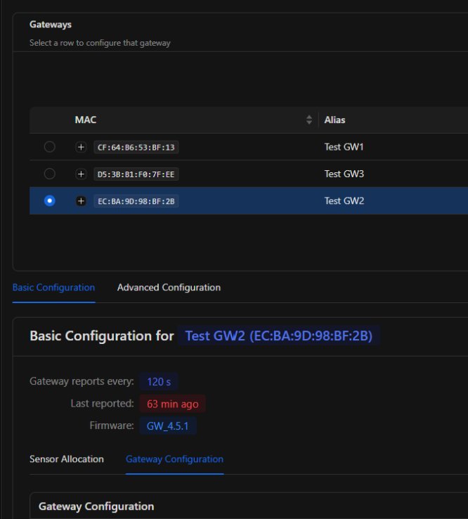

# Gateway setup guide

This guide covers activating, configuring and maintaining a gateway. You need access through the Admin UI and/or the mobile app before you start.

## 1. Activate a dormant gateway

A new gateway is dormant until it is activated.

=== "Mobile app (NFC)"

    1. Open the mobile app on your phone.
    2. Hold the phone against the gateway to make the NFC connection.
    3. Once connected, tap **Activate**.

    <!-- Screenshot: app activation screen. Save it as img/activate-app.png and use:
    { width="320" } -->

## 2. Configuration

### Report frequency (scan interval)

The report frequency controls how many scans the gateway performs before it reports to the broker.

!!! note "Default: 1 scan per report"
    Increasing this value makes the gateway report less often and extends its battery life.

=== "Admin UI"

    1. Open the Admin UI and select the gateway in the table.
    2. Go to **Basic Configuration → Gateway Configuration**.
    3. Change the report frequency value.

    { width="560" }

=== "Mobile app"

    1. Open the mobile app and connect to your gateway.
    2. Open the **REPORT** settings menu.
    3. Change the frequency value.

    <!-- Screenshot: app REPORT settings. Save it as img/report-settings-app.png -->

## 3. Maintenance

### Update firmware

=== "Admin UI"

    1. Open the Admin UI and select the gateway in the table.
    2. Go to **Basic Configuration → Gateway Configuration**.
    3. Select the new firmware version from the dropdown.

=== "Mobile app"

    1. Open the mobile app and connect to your gateway.
    2. Tap the menu icon in the top-left corner.
    3. Select **Update firmware version** to see the available firmwares.
    4. Select the version to push the update.

    <!-- Screenshot: app firmware menu. Save it as img/firmware-app.png -->

## 4. Whitelist

The whitelist is the gateway's list of approved sensors. A sensor must be on this list before the gateway accepts it.

!!! warning "Requirements"
    - You need the **ADMIN** role to change the whitelist.
    - A sensor can only be added to a gateway on the **same account**.

### Add a sensor to the whitelist

1. Open the Admin UI and select the gateway in the table.
2. Select the sensors you want to connect to the gateway.
3. If needed, set a cycle time for individual sensors.
4. The page calculates a shared scan interval from those cycle times, so the gateway has enough time to collect data from every sensor.
5. Start the whitelist process.
6. The page updates once the gateway confirms the change.

??? info "What happens during the whitelist process"
    1. The system sends a whitelist command to the gateway.
    2. The gateway checks the command, adds or removes the sensors from its approved list, and sends back its response.
    3. The system sends the cycle time update commands to the gateway.
    4. The gateway forwards each command to its sensor.
    5. Each sensor performs the command and answers the gateway, which answers the system.
    6. Finally a sync command tells the gateway and the sensors to start working on the same schedule.

!!! warning "Stay on the page"
    Do not leave the web page while the whitelist process is running. The progress is only tracked while the page is open.
