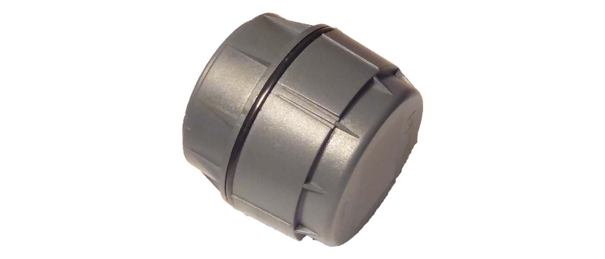

```{=openxml}
<w:p><w:pPr><w:jc w:val="center"/><w:spacing w:before="3600" w:after="360"/></w:pPr><w:r><w:rPr><w:b/><w:sz w:val="56"/><w:szCs w:val="56"/></w:rPr><w:t>R-IoT Radar Sensor</w:t></w:r></w:p>
<w:p><w:pPr><w:jc w:val="center"/><w:spacing w:after="120"/></w:pPr><w:r><w:rPr><w:sz w:val="36"/><w:szCs w:val="36"/></w:rPr><w:t>XM122 (A111)</w:t></w:r></w:p>
<w:p><w:pPr><w:jc w:val="center"/><w:spacing w:after="600"/></w:pPr><w:r><w:rPr><w:sz w:val="36"/><w:szCs w:val="36"/></w:rPr><w:t>User Manual</w:t></w:r></w:p>
```

{ width="480" }

```{=openxml}
<w:p><w:pPr><w:jc w:val="center"/><w:spacing w:before="360"/></w:pPr><w:r><w:rPr><w:i/></w:rPr><w:t>Firmware version 2.24</w:t></w:r></w:p>
<w:p><w:r><w:br w:type="page"/></w:r></w:p>
```

## Contents

| **1. Introduction**
| **2. SWEiot Toolbox App**
| **3. System configuration**
|     3.1 What the system settings controls
|     3.2 Commands
|     3.3 System parameter reference
| **4. Radar methods**
|     4.1 General measurement techniques
|     4.2 Customizable radar settings
|     4.3 Method 3 — Well
|     4.4 Method 4 — Bin
|     4.5 Method 5 — Parking
|     4.6 Method 6 — Seating
|     4.7 Method 7 — Adv_Seating
|     4.8 Method 8 — Distance2
| **5. Advanced configuration**
|     5.1 Payload content
|     5.2 Commands
|     5.3 Operation
|     5.4 Diagnostics
|     5.5 Settings by commands
|     5.6 Notes and tuning guide
|     5.7 Open API

```{=openxml}
<w:p><w:r><w:br w:type="page"/></w:r></w:p>
```
## 1. Introduction

R-IoT is an exceptionally versatile, compact, ultra-low-power radar
sensor designed to deliver reliable presence, distance, and level
measurements over many years of unattended operation.
By combining 60 GHz radar technology with Bluetooth Low Energy
communication and a robust mechanical design, R-IoT enables scalable
sensing solutions in both indoor and outdoor environments.

**This document targets advanced users** who require deeper insight into
how R-IoT operates and how it can be integrated into custom systems.
It complements the customer-facing installation manual by **focusing on
technical configuration concepts, radar behavior, and data integration**.

## 2. SWEiot Toolbox App

The R-IoT device radar unit can be configured using the SWEiot
Toolbox App available on Android. The app guides the user through
selecting a radar method and adjusting high-level parameters. To configure
R-IoT, you need:

- An Android device with Bluetooth Low Energy support
- The SWEiot Toolbox App installed (may be downloaded from Google Play)

For a short description of the SWEiot Toolbox:
<https://sweiot.gitbook.io/sweiot-docs/sweiot-toolbox-app/quick-start>.

***

## 3. System configuration

In addition to the settings available in the user interface of the
SWEiot Toolbox App and the "Commands and Logs" option in the main menu
it is also possible to send commands via the Open
API to the sensor when connected via a SWEiot gateway. Normally the 
SWEiot Admin tool offer all configuration options needed in this case.
Please note that this is for advanced users only — setting the wrong
parameters may cause the radar sensor to malfunction.

This chapter describes what the device-level system settings control,
the command interface, and the full system parameter reference. These
settings are shared by all measurement methods — per-method tuning is
documented in the method chapters.

### 3.1 What the system settings controls

The firmware runs one **measurement method** at a time (selected by
`curr_method`). A sample timer wakes the device every `sampl_int_s`
seconds (the interval belongs to the *method* configuration); 

Each wake-up:

- **Measures** — the current method executes, producing a result
   (distance, amplitude, occupancy, state, battery …). If the device is
   inactive (`active = 0`) no measurement is made.
- **Reports over BLE** — if the BLE transport is enabled, the result is
   packed into the Major/Minor fields of an **iBeacon advertisement**
   (UUID `bd79ca11-0bfa-41f4-a334-bf3ab66bb8XX`, last byte device-specific)
   and advertised for `adv_timeout_s` seconds at `adv_int_ms` interval.
   While advertising, the device is connectable and accepts commands over
   the Nordic UART Service.

In addition, independent timers can produce **periodic advertisements**
between measurements (`per_adv_s`) so the device stays visible/reachable
during long sampling intervals.

Settings are written as one comma-separated string with the `sys:` command,
persisted in flash, and survive reboot and DFU. A `factory` command clears
them (and all method settings) back to the compiled defaults below.

### 3.2 Commands

To communicate with the R-IoT unit, use the commands in the tables
below.

Commands are text strings sent over BLE (Nordic UART Service, while the
device advertises/is connected). Syntax:

* `name?` or `name` — query.
* `name:<data>` — set / execute.

All commands will return a string in which the first position indicates
whether the operation was successful or not. A `=` means success and `*`
means error. After the first position the command is echoed, followed by
possible further messages. In the case of `sys` and method settings
commands, the actual settings will be in this part. When a public key is
installed, commands must be suffixed with `#<hex signature>`.

```{=openxml}
<w:p><w:pPr><w:sectPr><w:pgSz w:w="12240" w:h="15840"/><w:pgMar w:top="1440" w:right="1440" w:bottom="1440" w:left="1440" w:header="720" w:footer="720"/></w:sectPr></w:pPr></w:p>
```

### 3.3 System parameter reference

Supplying more than 15 fields, an invalid method number, or `transport = 0`
rejects the whole string and restores the previous configuration
(response `*sys:Invalid config`).

#### 3.3.1 Method selection and activation

| # | Parameter       | Default | Min | Max | Unit | Effect |
|-----|--------------------|---------|-------|-------|-------|---------------------------------------------|
| 1 | Selected Method | 0       | 0   | 8   | –    | Index of the active measurement method: **0** Distance 1, **2** Speed, **3** Well, **4** Bin, **5** Parking, **6** Seating, **7** Adv_Seating, **8** Distance2.1. (1 is unused.) Changing it stops the previous method and initialises the new one. An invalid index rejects the configuration. |
| 6 | Radar on        | 0       | 0   | 1   | –    | **0 = inactive**: no measurements are made — each timer tick still advertises so the device stays configurable. **1 = active**: normal measuring. New devices ship inactive — set to 1 to start measuring. |
| 8 | Send on change  | 0       | 0   | 1   | –    | **0** = transmit every measurement result. **1** = transmit only results the method flags as changed (e.g. Adv_Seating chair mode: state changes only). Reduces radio traffic and power; makes the device silent while nothing happens. |

#### 3.3.2 BLE advertising

| #  | Parameter                   | Default | Min | Max   | Unit | Effect |
|-----|--------------------|---------|-------|-------|-------|---------------------------------------------|
| 2  | Advertisement Interval (ms) | 250     | 25  | 10000 | ms   | Interval between advertisement packets while advertising. Lower → scanner picks the beacon up faster, higher power. Keep within 25–10000 ms (the firmware caps at 10000). |
| 3  | Advertisement timeout (s)   | 4       | 1   | 3600  | s    | How long the device advertises after each measurement. This is also the window in which a BLE central can connect and send commands. Longer → easier to catch/connect, higher power. |
| 4  | Bluetooth mode              | 0       | 0   | 2     | –    | PHY selection: **0** = normal (1M) only, **1** = alternate normal / long-range on successive advertisements, **2** = long-range (coded PHY) only. Long range roughly quadruples reach but is invisible to scanners without BLE 5 coded-PHY support (most phones). Periodic/NFC advertisements always use the normal PHY. |
| 5  | Tx power                    | 8       | -40 | 8     | dBm  | Radio transmit power (nRF52 steps, −40 … +8). 8 = maximum range; lower to save power or limit reach. |
| 15 | Advertisement format        | 0       | 0   | 1     | –    | Payload format of the advertisement: **0** = iBeacon (values bit-packed into the Major/Minor fields), **non-zero** = extended manufacturer-specific message carrying the values at full resolution. See *Payload content* above for the byte layout of each. |

#### 3.3.3 Periodic and NFC advertisements

| #  | Parameter                     | Default | Min | Max   | Unit | Effect |
|-----|--------------------|---------|-------|-------|-------|---------------------------------------------|
| 9  | Periodic advertisment         | 0       | 0   | 86400 | s    | Extra advertisement every N seconds *between* measurements, repeating the last result. **0 = off.** Only active when shorter than the current method's sampling interval. Use with long sampling intervals to keep the device findable/connectable. |
| 10 | Periodic advertisment timeout | 10      | 1   | 3600  | s    | Advertising duration of each periodic advertisement. |
| 11 | NFC advertisement timeout     | 20      | –   | –     | s    | Not used on R-IoT (BLE) devices — leave at the default. |

#### 3.3.4 Transport and reserved fields

| #  | Parameter                                    | Default | Min | Max | Unit | Effect |
|-----|--------------------|---------|-------|-------|-------|---------------------------------------------|
| 7  | Network configuration                        | 1       | 1   | 3   | –    | Radio transport selection. **Leave at 1 (BLE) on R-IoT devices.** 0 is rejected; setting 2 (LoRa only) stops all BLE reporting and makes the device unreachable over the air. |
| 12 | Secure Mode via Lora                         | 0       | –   | –   | –    | Reserved (LoRa devices only) — leave at 0. Note that BLE commands always require a signature whenever a public key is installed with `key:`. |
| 13 | Distance in mm for Lora                      | 0       | –   | –   | –    | Reserved (LoRa devices only) — leave at 0. |
| 14 | Parameter change confirmation sent over Lora | 60      | –   | –   | min  | Reserved (LoRa devices only) — leave at the default. |

***

```{=openxml}
<w:p><w:pPr><w:sectPr><w:pgSz w:w="15840" w:h="12240" w:orient="landscape"/><w:pgMar w:top="1440" w:right="1440" w:bottom="1440" w:left="1440" w:header="720" w:footer="720"/></w:sectPr></w:pPr></w:p>
```

## 4. Radar methods

Several predefined methods for operating the radar and analyzing the
results are included as standard in R-IoT. Each method can be
configured for different use case specifics. Each radar method uses
different measurement techniques that are further described below. The
following sections also give an overview of available methods for this
firmware version.

### 4.1 General measurement techniques

The general measurement techniques outlined below are adaptable,
addressing a broad range of applications through various approaches. The
following represent the primary methods employed.

**Closest Object Detection**

This method pinpoints the nearest object that reflects a signal
surpassing a preset amplitude threshold within a defined measurement
range.

**Farthest Object Detection**

It identifies the most distant object exceeding a specific reflection
amplitude threshold, also within a predetermined measurement range.

**Largest Reflection Detection**

This technique detects the object that produces the most significant
reflection echo within the designated measurement distance.

#### 4.1.1 Parking Monitoring

Technique Used: **Largest Reflection Detection**

The parking method detects the largest radar signal echo above a defined
threshold within a specified measurement range, making it ideal for
identifying a vehicle or large object in a well-defined area. To
optimize coverage, a normal or narrow lens should be selected based on
the width of the target zone, with the option to use a beam-forming lid
to narrow the monitored area further.

In terms of functionality, the method determines occupancy status
(occupied/unoccupied) while providing the specific distance and echo
amplitude of the detected object.

Battery Optimization: Tailored for a 10-year battery lifespan with a
sensor scan interval of 30 seconds for parking use cases, and extendable
beyond 10 years for user scenarios permitting longer scan intervals.

#### 4.1.2 Well Level Measurement

Technique Used: **Farthest Object Detection**

This method accurately measures the water level in a well by returning
the distance and amplitude of the radar echo at the largest distance
within the measurement range, provided it is above the sensitivity
threshold. It is well suited for applications where the most distant
echo represents the correct object to measure, meaning any closer echoes
will be completely neglected.

Battery Optimization: 10 years of battery life with a 10-minute sensor
scan cycle.

##### Example of usage

Examples of applications suited for the well method include:

- Wells
- Septic tanks
- Snow level (Snow level = Distance to ground − Distance to snow)
- Water level (Water level = Reference ground level − Distance to water)

The method may return false values if the dominating radar echo
originates from an unintended radar path (see Figure 1 below):

1. Radar reflections in the sidewall.
2. Radar echoes reflected in the sensor, the sensor mounting or any
   lid/construction above the sensor.
3. Radar echoes from the actual bottom of the well.


##### General guidelines

Determine carefully the mounting position and range of your measurement
to minimize the occurrence of false echoes. E.g.

- "Length of Range" < distance from the R-IoT sensor to the bottom
  of the well − 10 cm.
- Distance to the highest possible water level in the well should
  preferably be larger than ("Start of Range" + "Length of Range") / 2.
- Position the device to avoid reflections in the side walls.
- Pay attention to the environment around and above the device to
  minimize that the radar is reflected and bounces back. Avoid large
  reflective materials (metal etc).
- In most cases, R-IoT with the narrow lens will perform better for
  these applications. A radar beam-forming lid with a round aperture can
  be purchased from SWEiot to further narrow the radar beam, used
  together with the R-IoT narrow lens.

#### 4.1.3 Bin method

Technique Used: **Closest Object Detection**

The bin method detects when a waste container needs emptying by
measuring the distance and signal strength to the nearest object. This
method features adjustable sensitivity to either detect or ignore
lightweight materials close to the sensor. A narrow lens is recommended
for these applications to keep the radar beam focused.

Because the system is sensitive to nearby objects, small unwanted
reflections can be avoided by raising the threshold level. Temporary
interference, such as raindrops, can be filtered out by increasing the
average factor. For installation, the sensor can be mounted directly
above the bin to measure the distance down to the waste. It can also be
mounted on a side wall to look across the top of the container.

Battery Optimization: Designed to last up to 10 years with a scanning
interval of every 10 minutes.

#### 4.1.4 Distance method

This is a generic distance measurement method with the same common
configuration parameters as the other methods but with some extra
possibilities to select the closest, strongest or most distant object
detected by the radar. When the strongest reflection is considered,
there is the option to compensate for the decrease of signal strength
dependent on the distance and the shape of the object, i.e. round or
flat.

#### 4.1.5 Seating method

The seating method will return the distance and amplitude at the largest
radar signal echo within the defined measurement range and above the
defined threshold. The method also reports if the seat is considered
occupied or free. The state changes from occupied to free and vice
versa when a configurable number of consecutive measurements show the
same result. The number of consecutive measurements is configurable
separately for each direction.

R-IoT with the narrow lens is usually most suitable for seating
applications.

The detection works best in a setup where obstacles around the seat are
defined, e.g. cars, buses and trains. Mount the R-IoT sensor and
finetune the distance and threshold to get a firm detection in a
representative seat. Adjust the parameter values for switching between
occupied and free seats, to filter out temporary events and further
improve the reliability of the measurement.

#### 4.1.6 Advanced Seating method

The advanced seating method is an extended version of the seating method
for demanding occupancy applications. Presence detection in a main zone
is combined with a reference echo from a seat zone behind the person
(seat back, floor or wall) that is visible only when the seat is empty,
and a four-state state machine (free, confirming occupied, occupied,
confirming free) filters out temporary events before the occupancy state
changes.

Each state has its own measurement interval, so the sensor measures
quickly while a change is being confirmed and slowly while the state is
stable. Up to two exclusion zones can mask out fixed reflectors such as
armrests or table edges. An optional wheelchair mode classifies a
detected object as either a wheelchair or another object (e.g. luggage),
for example for accessible seating areas. In normal (chair) mode the
sensor only transmits when the occupancy state changes, which keeps
radio traffic and power consumption low.

Battery Optimization: the per-state measurement intervals mean the
sensor only measures fast during the short confirmation phases,
preserving multi-year battery life even with fast reaction times.

For all details, see the *Method 7 — Adv_Seating* chapter.

### 4.2 Customizable radar settings

Every measurement environment is unique, bringing its own set of
challenges such as physical obstacles, weather conditions, or background
noise. To ensure high accuracy and reliable data, the R-IoT sensor
features a variety of customizable settings. These parameters allow you
to fine-tune how the radar perceives its surroundings, filters out
interference, and detects targets. By understanding and adjusting these
settings, you can optimize both the precision and the energy efficiency
of the device for your specific use case.

#### 4.2.1 Range

In general, the operation range of the module is dependent on the sensor,
however the range may vary depending on the structure and material of
the object of interest. Note that the actual range is affected by the
CFAR-window parameter if the threshold method CFAR is used.

#### 4.2.2 HWAAS

HWAAS (HW Accelerated Average Samples), number of samples taken to
obtain a single point in the data. These are averaged directly in the
sensor hardware — no extra computations are done in the CPU.

The time needed to measure a sweep is roughly proportional to the HWAAS.
Hence, if there's a need to obtain a higher sweep rate, HWAAS could be
decreased. Note that HWAAS does not affect the amount of data
transmitted from the sensor.

Must be at least 1 and not greater than 63.

#### 4.2.3 Averaging

To decrease the effects of environmental noise and increase overall
signal quality, multiple radar sweeps can be averaged. This process
effectively stabilizes measurement results, filters out unwanted signals
from moving objects, and improves the reliability of detected signals.

However, collecting and processing multiple sweeps takes time and
increases power consumption. The optimal number of sweeps for averaging
is therefore highly dependent on your specific use case, requiring a
balance between data precision and battery efficiency.

#### 4.2.4 Median

To get better precision in the distance value, a median algorithm with a
delay option may be applied as an alternative to the straightforward
averaging measurement described above. The signal amplitudes for each
index in the arrays created by the sweeps are sorted and a result array
based on middle values, i.e. a median algorithm, is used for detecting
the peaks. To further improve the measurement a delay may be applied
between the sweeps to allow the object of interest to change or move
slightly, e.g. a water surface.

#### 4.2.5 Threshold

To be able to determine if any objects are present, the measurement
needs to be compared to a threshold. Here, different thresholds
can be employed, each suitable for different use-cases.

##### Fixed threshold

The most simple approach to setting the threshold is choosing a fixed
threshold over the full range. This approach requires that no background
objects are present that can trigger detection.

##### CFAR (Constant False Alarm Rate) threshold

Another method to construct a threshold for a certain distance is to use
the envelope signal from neighboring distances *from the same sweep*.
This requires that the object gives rise to a single strong peak, such
as a water surface and not, for example, the level in a large waste
container. The main advantage is that the memory consumption is minimal
and that no noise normalization is required.

When using the CFAR threshold, no detections will be made outside of the
range [range_start + (guard / 2) + window, range_end − (guard / 2) −
window].

For example, if the range is set to 0.20 m (start) / 4.8 m (length) and
guard = 0.2 and window = 0.09, the practical range will be:

[0.2 + (0.2 / 2) + 0.09, 0.2 + 4.8 − (0.2 / 2) − 0.09] = [0.39, 4.81]

#### 4.2.6 Peak sorting

Depending on the use-case, one peak is often the most important.
Therefore, several different peak sorting methods are available.

For example, if the threshold is low (high sensitivity), the noise can
give false alarms and the strongest peak is probably of interest. With a
high threshold, on the other hand, all detected peaks are likely real
objects, and the closest peak is probably of highest interest.

*Closest*

This method simply sorts the peaks by distance, with the closest first.

*Most distant*

As for the closest peak, the most distant peak may be of interest, e.g.
in a well with obstacles that may give strong reflections at a closer
distance than the water surface below.

*Strongest*

Here, the peaks are sorted after their envelope amplitude, with the
strongest first.

*Strongest reflector*

This method will compensate for the fact that the same object at a larger
distance from the radar will give a weaker signal.

*Strongest flat reflector*

For large flat reflectors, such as fluid surfaces, the radar equation
from the previous section is slightly modified.

***

### 4.3 Method 3 — Well

Radar water-level measurement for the R-IoT sensor (XM122, A111
radar). The sensor looks
down into a well and reports the distance to the water surface — the **most
distant** echo in the measured range. Includes an optional adaptive range
that follows the water surface, and a median filter for stable readings.

***

#### 4.3.1 What the method does

Each measurement cycle (every `sampl_int_s` seconds):

1. **Collects sweeps** — the radar performs `average_fact` sweeps over the
   range, with `median_sleep` ms between sweeps.
2. **Filters and finds the surface** — two alternative modes:
   * **Median mode (`median = 1`, default):** a per-bin median across the
     sweeps is computed. Local maxima above `fix_threshold_sens` are found
     (flat plateaus count as one peak, reported at their middle), and the
     **last (most distant)** peak is reported — the water surface.
   * **Average mode (`median = 0`):** the SDK distance detector's own peak
     list is used with the **CFAR threshold** (parameters 6–8), and the most
     distant of the reported peaks is selected.
3. **Reports** — distance (mm) and amplitude of the surface echo. If no echo
   exceeds the threshold, distance 0 is reported (with `debug = 1`, the
   highest amplitude seen is still reported, without distance).

##### Adaptive range (`adaptive_range` > 0)

Instead of sweeping the whole configured window every cycle, the sweep is
narrowed to `adaptive_range` meters centred on the last detected surface:

* After a successful measurement, the next sweep runs from
  `surface − adaptive_range/2` over `adaptive_range` meters, clamped to the
  configured window. The detector is re-created every cycle.
* If the surface echo is **lost**, one immediate re-measurement is triggered
  (the "rerun" mechanism), using the full configured window again so a fast
  water-level change can be re-acquired.
* The reported `range_start`/`range_length` show the narrow window actually
  used; the configured window is unchanged in the settings.

A narrow window measures faster and saves power, at the cost of the
re-acquisition step when the level moves outside the window between cycles.

##### Reporting and housekeeping

* Every executed measurement is reported (the method never suppresses a
  result).
* `occupied`, `state` and `object` are not used by this method.
* Base-class housekeeping applies: if the module temperature changes more
  than 5 °C since the last calibration, the detector is automatically
  re-created (recalibrated) before measuring.
* This method has **no** `meth_cmd` diagnostic commands (any command answers
  "Unknown method command").

***

```{=openxml}
<w:p><w:pPr><w:sectPr><w:pgSz w:w="12240" w:h="15840"/><w:pgMar w:top="1440" w:right="1440" w:bottom="1440" w:left="1440" w:header="720" w:footer="720"/></w:sectPr></w:pPr></w:p>
```

#### 4.3.2 Parameter reference

Parameters are sent as one comma-separated string, in this exact order.
Default string (compiled-in values when no configuration is present):

```
300,20,0.500,3.000,3.00,0.650,0.200,0.090,0,0.000,1,200,1000,2,0
```

| #  | Parameter                       | Default | Min  | Max   | Unit      | Effect |
|-----|--------------------|---------|-------|-------|-------|---------------------------------------------|
| 1  | Measurement cycle (s)           | 300     | 1    | 86400 | s         | Measurement interval. |
| 2  | HW acceleration average samples | 20      | 1    | 63    | –         | Hardware-accelerated averaging per sweep point. Higher → better signal-to-noise, longer measurement, more power. |
| 3  | Start of range (m)              | 0.500   | 0.06 | 5     | m         | Near edge of the measured window (top of the well). |
| 4  | Length of range (m)             | 3.000   | 0.1  | 5     | m         | Length of the measured window. Must reach below the lowest expected water level. |
| 5  | Average factor                  | 3.0     | 1    | 20    | sweeps    | Number of sweeps collected and combined per measurement. More sweeps → steadier median, longer measurement, more RAM (buffer must stay under ~120 kB). |
| 6  | Sensitivity level               | 0.650   | 0    | 1     | 0–1       | CFAR threshold sensitivity — **average mode only**. Higher → more sensitive (more peaks). |
| 7  | cfar threshold guard            | 0.200   | 0.01 | 0.2   | m         | CFAR guard interval around each point — average mode only. |
| 8  | cfar threshold window           | 0.090   | 0.01 | 0.2   | m         | CFAR averaging window — average mode only. |
| 9  | Offset                          | 0       | –    | –     | –         | Parsed and stored but **currently has no effect** (the offset correction is commented out in the code). |
| 10 | AdaptiveRange                   | 0.000   | 0    | 5     | m         | 0 = always sweep the full window. > 0 = width of the adaptive window that follows the water surface (see the method description above). |
| 11 | Median filter                   | 1       | 0    | 1     | –         | 1 = median mode (own peak detection on the median array, threshold = parameter 12). 0 = average mode (SDK CFAR peaks, parameters 6–8). |
| 12 | Fixed / Median threshold        | 200     | 0    | 65535 | amplitude | Echo threshold in **median mode**. Lower → detects weaker surface echoes (and more noise); higher → only strong echoes count. |
| 13 | Median Sweep Delay              | 1000    | 0    | 60000 | ms        | Pause between the individual sweeps. Longer pauses let ripples/waves decorrelate so the median is more representative. |
| 14 | Profile                         | 2       | 1    | 5     | –         | Radar service profile 1–5. Higher profiles give more signal for deep wells at the cost of distance resolution. |
| 15 | Debug                           | 0       | 0    | 1     | –         | 1 = when no echo exceeds the threshold, still report the highest amplitude found (distance stays 0). Useful when tuning the threshold. |

##### Fixed settings (not in the parameter string)

* Threshold type is CFAR for the SDK detector (only relevant in average
  mode); peak sorting "strongest reflector first"; downsampling factor 1;
  power-save mode OFF.

***

```{=openxml}
<w:p><w:pPr><w:sectPr><w:pgSz w:w="15840" w:h="12240" w:orient="landscape"/><w:pgMar w:top="1440" w:right="1440" w:bottom="1440" w:left="1440" w:header="720" w:footer="720"/></w:sectPr></w:pPr></w:p>
```

#### 4.3.3 Reported result fields

| Field                          | Meaning |
|--------------------------|--------------------------------------------------------------------------|
| `dist_100` / `amplitude`       | Distance (mm) and amplitude of the selected (most distant) echo — the water surface. 0 / 0 when nothing exceeded the threshold (with `debug = 1` the amplitude is still filled in). |
| `range_start` / `range_length` | Window actually swept this cycle (mm) — the adaptive window when adaptive range is active. |

#### 4.3.4 Tuning guide

* **Surface not detected:** lower `fix_threshold_sens` (median mode) or
  raise `threshold_sens` (average mode); raise `samples`; consider a higher
  `profile` for deep wells.
* **Jumpy readings from ripples:** keep median mode, raise `average_fact`
  and/or `median_sleep` so the sweeps span more wave periods.
* **Echoes from the well wall reported instead of water:** the method already
  picks the most distant peak, so wall echoes above the surface are usually
  ignored — but check with `debug = 1` and raise the threshold above the
  wall-echo amplitude if needed.
* **Battery drain:** lengthen `sampl_int_s`; enable `adaptive_range` so only
  a narrow window is swept; reduce `samples`/`average_fact`.

***

### 4.4 Method 4 — Bin

Radar fill-level / presence measurement for containers (waste bins) with the
R-IoT sensor (XM122, A111 radar). The sensor looks into the bin and
reports the distance to
the **closest** echo above the threshold, plus a debounced `occupied` flag.

***

#### 4.4.1 What the method does

Each measurement cycle (every `sampl_int_s` seconds):

1. The SDK distance detector sweeps the configured range with a **fixed
   amplitude threshold** (`fix_threshold_sens`) and reports its peaks sorted
   **closest first**.
2. The **first (closest) peak** is taken as the result: its distance (mm,
   plus `offset`) and amplitude are reported. No peak → distance 0.
3. The `occupied` flag is debounced with a 3-step counter:
   * every cycle **with** a detection counts up (capped at 3); when the
     counter reaches 3, `occupied = 1`.
   * every cycle **without** a detection counts down; when the counter
     reaches 0, `occupied = 0`.

   So it takes 3 consecutive detections to assert `occupied`, and as many
   detection-free cycles as the counter has accumulated (at most 3) to clear
   it. The counter step count is fixed in code, not configurable.

##### Reporting and housekeeping

* Every executed measurement is reported (the method never marks a result as
  unchanged).
* No median filtering and no sweep-collection callback — the SDK detector's
  built-in sweep averaging (factor 4) is used directly.
* Base-class housekeeping applies: if the module temperature changes more
  than 5 °C, the detector is automatically re-created (recalibrated).
* This method has **no** `meth_cmd` diagnostic commands.

***

```{=openxml}
<w:p><w:pPr><w:sectPr><w:pgSz w:w="12240" w:h="15840"/><w:pgMar w:top="1440" w:right="1440" w:bottom="1440" w:left="1440" w:header="720" w:footer="720"/></w:sectPr></w:pPr></w:p>
```

#### 4.4.2 Parameter reference

Parameters are sent as one comma-separated string, in this exact order.
Default string (compiled-in values when no configuration is present):

```
120,20,0.150,1.000,290,0
```

| # | Parameter                       | Default | Min  | Max   | Unit      | Effect |
|-----|--------------------|---------|-------|-------|-------|---------------------------------------------|
| 1 | Measurement cycle (s)           | 120     | 1    | 86400 | s         | Measurement interval. |
| 2 | HW acceleration average samples | 20      | 1    | 63    | –         | Hardware-accelerated averaging per sweep point. Higher → better signal-to-noise, longer measurement, more power. |
| 3 | Start of range (m)              | 0.150   | 0.06 | 5     | m         | Near edge of the measured window (just below the sensor/lid). |
| 4 | Length of range (m)             | 1.000   | 0.1  | 5     | m         | Length of the window — should reach the bottom of the empty bin. |
| 5 | Threshold level                 | 290     | 0    | 65535 | amplitude | Detection threshold. **Lower → more sensitive** (weaker content echoes detected, more false detections); **higher → less sensitive**. The main tuning knob. |
| 6 | Offset                          | 0       | –    | –     | mm        | Correction **added** to the reported distance when a peak is found (mounting offset compensation). No effect when no peak is found. |

##### Fixed settings (not in the parameter string)

* Radar profile 2, downsampling factor 2, SDK sweep averaging 4, power-save
  mode OFF, fixed threshold type, peak sorting **closest first**.
* The occupied debounce depth (3) is hard-coded.

***

```{=openxml}
<w:p><w:pPr><w:sectPr><w:pgSz w:w="15840" w:h="12240" w:orient="landscape"/><w:pgMar w:top="1440" w:right="1440" w:bottom="1440" w:left="1440" w:header="720" w:footer="720"/></w:sectPr></w:pPr></w:p>
```

#### 4.4.3 Reported result fields

| Field                          | Meaning |
|--------------------------|--------------------------------------------------------------------------|
| `dist_100` / `amplitude`       | Closest above-threshold echo: distance (mm, incl. `offset`) and amplitude. 0 / 0 when nothing exceeded the threshold. The distance is effectively the fill level (smaller distance = fuller bin). |
| `occupied`                     | Debounced presence flag (see the method description above). |
| `range_start` / `range_length` | Configured window (mm). |

#### 4.4.4 Tuning guide

* **Content not detected / level jumps to 0:** lower `fix_threshold_sens`;
  raise `samples`. Soft, absorbing waste gives weak echoes.
* **False detections from the bin itself (walls, welds, lid):** raise
  `fix_threshold_sens`, or move `range_start` past the offending reflector.
* **Reported distance off by a constant:** set `offset` (mm) to compensate
  for the mounting position.
* **Battery drain:** lengthen `sampl_int_s`; reduce `samples`.

***

### 4.5 Method 5 — Parking

Radar parking-spot occupancy detection for the R-IoT sensor (XM122,
A111 radar). The sensor
looks up/out at the parking spot; a strong reflection anywhere in the range
means a vehicle is present. This is the simplest occupancy method in the
firmware — one amplitude threshold, no state machine, no debounce.

***

#### 4.5.1 What the method does

Each measurement cycle (every `sampl_int_s` seconds):

1. One raw **envelope sweep** is taken over the configured range (this method
   uses the envelope service directly, not the distance detector — there is
   no threshold or peak logic in the radar itself).
2. The strongest point of the sweep is found: its amplitude and distance are
   reported.
3. **`occupied` = 1 when the maximum amplitude is ≥ 350** (hard-coded
   threshold), else 0. A single sweep decides — there is no filtering or
   hysteresis, so the mounting and range must be chosen so that a vehicle
   reliably produces a strong echo and an empty spot does not.
4. The result is flagged as **changed only when the occupancy flips**, so
   with the system setting `send_change_only = 1` the sensor only transmits
   on arrival/departure. With `send_change_only = 0` every measurement is
   transmitted.

##### Housekeeping

* Base-class housekeeping applies: if the module temperature changes more
  than 5 °C, the service is automatically re-created (recalibrated).
* This method has **no** `meth_cmd` diagnostic commands.

***

```{=openxml}
<w:p><w:pPr><w:sectPr><w:pgSz w:w="12240" w:h="15840"/><w:pgMar w:top="1440" w:right="1440" w:bottom="1440" w:left="1440" w:header="720" w:footer="720"/></w:sectPr></w:pPr></w:p>
```

#### 4.5.2 Parameter reference

Parameters are sent as one comma-separated string, in this exact order.
Default string (compiled-in values when no configuration is present):

```
30,10,0.200,1.500
```

| # | Parameter                       | Default | Min  | Max   | Unit | Effect |
|-----|--------------------|---------|-------|-------|-------|---------------------------------------------|
| 1 | Measurement cycle (s)           | 30      | 1    | 86400 | s    | Measurement interval — the worst-case delay before an arrival or departure is noticed. |
| 2 | HW acceleration average samples | 10      | 1    | 63    | –    | Hardware-accelerated averaging per sweep point. Higher → better signal-to-noise, longer measurement, more power. |
| 3 | Start of range (m)              | 0.200   | 0.06 | 5     | m    | Near edge of the measured window. |
| 4 | Length of range (m)             | 1.500   | 0.1  | 5     | m    | Length of the window — should cover the underside/side of a parked vehicle but not reach reflectors beyond the spot. |

##### Fixed settings (not in the parameter string)

* **Occupancy amplitude threshold: 350 (hard-coded).** The only way to
  influence the decision is via `samples`, the range, profile-independent
  mounting, and the sweep window.
* Radar profile 2, downsampling factor 4, running-average factor 0,
  power-save mode OFF.
* The reported distance is computed with a fixed 2 mm-per-point scale from
  the sweep index.

***

```{=openxml}
<w:p><w:pPr><w:sectPr><w:pgSz w:w="15840" w:h="12240" w:orient="landscape"/><w:pgMar w:top="1440" w:right="1440" w:bottom="1440" w:left="1440" w:header="720" w:footer="720"/></w:sectPr></w:pPr></w:p>
```

#### 4.5.3 Reported result fields

| Field                          | Meaning |
|--------------------------|--------------------------------------------------------------------------|
| `dist_100` / `amplitude`       | Strongest point of the sweep: distance (mm) and amplitude. Reported even when the spot is free. |
| `occupied`                     | 1 when the strongest amplitude ≥ 350. |
| `range_start` / `range_length` | Configured window (mm). |
| `changed`                      | True only when `occupied` flipped since the previous measurement. |

#### 4.5.4 Tuning guide

* **Vehicle not detected:** raise `samples`; shorten the range so it ends at
  the expected vehicle distance (a shorter sweep concentrates on the target);
  check the mounting angle — the 350 threshold is fixed, so the installation
  must deliver a strong echo.
* **False occupancy from ground/kerb/rain gratings:** move `range_start`
  past the offending reflector, or shorten `range_length` so the window only
  covers where the vehicle body can be.
* **Flapping occupancy on marginal echoes:** there is no hysteresis in this
  method — if the echo amplitude hovers around 350, adjust the range/mounting
  or consider method 7 (Adv_Seating) style methods with state filtering.
* **Battery drain:** lengthen `sampl_int_s` (30 s default is aggressive);
  enable `send_change_only` in the system settings so only arrivals and
  departures are transmitted.

***

### 4.6 Method 6 — Seating

Radar seating occupancy detection for the R-IoT sensor (XM122, A111
radar) — the simple
predecessor of method 7 (Adv_Seating). A person in the measured range
produces an echo above a fixed threshold; a consecutive-count filter turns
that into a stable `occupied` flag. There are no zones, no seat-reference
echo, no per-state cycle times — for those, use method 7.

***

#### 4.6.1 What the method does

Each measurement cycle (every `sampl_int_s` seconds):

1. The SDK distance detector sweeps the configured range with a **fixed
   amplitude threshold** (`fix_threshold_sens`) and reports its peaks sorted
   **strongest first**.
2. The **first (strongest) peak** is taken as the result: its distance
   (mm, plus `offset`) and amplitude are reported. No peak → distance 0.
3. The detection (peak found / not found) feeds a consecutive-count state
   filter:
   * `required_occupied` consecutive detections switch the state to
     **occupied**;
   * `required_free` consecutive detection-free cycles switch it back to
     **free**;
   * any opposite sample resets the respective counter, so intermittent
     echoes/dropouts do not flip the state.
4. `occupied` = the filter state. The state starts as **free** after power-on
   or re-initialisation (note: method 7 starts as occupied instead).

##### Reporting and housekeeping

* Every executed measurement is reported (the method never marks a result as
  unchanged) — the state filter stabilises the value, not the transmission
  rate.
* Base-class housekeeping applies: if the module temperature changes more
  than 5 °C, the detector is automatically re-created (recalibrated). Note
  that re-initialisation also resets the occupancy filter to free.
* This method has **no** `meth_cmd` diagnostic commands.

***

```{=openxml}
<w:p><w:pPr><w:sectPr><w:pgSz w:w="12240" w:h="15840"/><w:pgMar w:top="1440" w:right="1440" w:bottom="1440" w:left="1440" w:header="720" w:footer="720"/></w:sectPr></w:pPr></w:p>
```

#### 4.6.2 Parameter reference

Parameters are sent as one comma-separated string, in this exact order.
Default string (compiled-in values when no configuration is present):

```
60,30,0.240,1.000,200,0,3,3
```

| # | Parameter                       | Default | Min  | Max   | Unit      | Effect |
|-----|--------------------|---------|-------|-------|-------|---------------------------------------------|
| 1 | Measurement cycle (s)           | 60      | 1    | 86400 | s         | Measurement interval. Together with the counters it sets the reaction time: occupied after `required_occupied × sampl_int_s`, free after `required_free × sampl_int_s` (defaults: 3 min each). |
| 2 | HW acceleration average samples | 30      | 1    | 63    | –         | Hardware-accelerated averaging per sweep point. Higher → better signal-to-noise, longer measurement, more power. |
| 3 | Start of range (m)              | 0.240   | 0.06 | 5     | m         | Near edge of the measured window. |
| 4 | Length of range (m)             | 1.000   | 0.1  | 5     | m         | Length of the window — should cover where a seated person's body can be, and not reach beyond the seat. |
| 5 | Threshold level                 | 200     | 0    | 65535 | amplitude | Detection threshold. **Lower → more sensitive** (weaker echoes count as a person, more false occupancy); **higher → less sensitive**. The main tuning knob. |
| 6 | Offset                          | 0       | –    | –     | mm        | Correction **added** to the reported distance when a peak is found. No effect on the occupancy decision. |
| 7 | steps to occupied               | 3       | 1    | 100   | cycles    | Consecutive detections needed to switch to occupied. Higher → slower but safer occupancy assertion (ignores someone briefly leaning in). |
| 8 | steps to free                   | 3       | 1    | 100   | cycles    | Consecutive empty cycles needed to switch to free. Higher → tolerates echo dropouts from a sitting person, at the cost of a slower free report. |

##### Fixed settings (not in the parameter string)

* Radar profile 2, downsampling factor 2, SDK sweep averaging 4, power-save
  mode OFF, fixed threshold type, peak sorting **strongest first**.

***

```{=openxml}
<w:p><w:pPr><w:sectPr><w:pgSz w:w="15840" w:h="12240" w:orient="landscape"/><w:pgMar w:top="1440" w:right="1440" w:bottom="1440" w:left="1440" w:header="720" w:footer="720"/></w:sectPr></w:pPr></w:p>
```

#### 4.6.3 Reported result fields

| Field                          | Meaning |
|--------------------------|--------------------------------------------------------------------------|
| `dist_100` / `amplitude`       | Strongest above-threshold echo: distance (mm, incl. `offset`) and amplitude. 0 / 0 when nothing exceeded the threshold. |
| `occupied`                     | The debounced occupancy state (see the method description above). |
| `range_start` / `range_length` | Configured window (mm). |

#### 4.6.4 Tuning guide

* **False occupancy from a fixed reflector (chair back, table edge):** raise
  `fix_threshold_sens`, or trim the range so the window only covers the
  person. This method has no exclusion zones — if the reflector cannot be
  avoided, use method 7.
* **Occupied person reported free (echo dropouts):** raise `required_free`;
  lower `fix_threshold_sens`; raise `samples`.
* **Reaction too slow:** shorten `sampl_int_s` or lower the counters — but
  each detection error then has more impact.
* **Battery drain:** lengthen `sampl_int_s`; reduce `samples`. For per-state
  measurement rates (fast while confirming, slow while stable), use method 7.

***

### 4.7 Method 7 — Adv_Seating

Radar-based seating occupancy detection for the R-IoT sensor (XM122,
A111 radar), with a
four-state occupancy state machine, per-state measurement rates, and optional
wheelchair classification.

***

#### 4.7.1 What the method does

The sensor is mounted so it looks across/over a seat. Each measurement cycle it:

1. **Collects sweeps** — the radar performs `average_fact` sweeps over the
   configured range, with `median_sleep` ms between sweeps.
2. **Filters** — for every distance bin, the median (`detection = 2`) or
   average (`detection = 3`) amplitude across the sweeps is computed. This
   filtered array is what all detection logic works on.
3. **Detects echoes in zones** — the *main zone* (where a person's body is
   expected) and, in some states, the *seat zone* (a reference reflection
   behind/beyond the person, visible only when the seat is empty). A zone
   "has an echo" when any bin in it is at or above the zone's amplitude
   threshold. Exclusion zones can mask out or re-threshold parts of the sweep.
4. **Runs the state machine** — echo results drive transitions between
   FREE, AIM_BUSY, BUSY and AIM_FREE. The AIM_* states are short confirmation
   phases that prevent single noisy samples from flipping the occupancy.
5. **Reports** — occupancy, state, distances, amplitudes and cycle time. In
   chair mode a result is transmitted only on state change; in wheelchair mode
   every executed measurement is transmitted.

##### The two detection zones

```
sensor ──► |––– main zone –––|        |––– seat zone –––|
           0.30 m      0.86 m        1.30 m        1.60 m   (defaults)

main zone : where the person sits. Echo here  => someone is present.
seat zone : reference target behind the person (seat back / floor / wall).
            Echo here => seat is EMPTY (person would block it).
            No echo   => seat is likely OCCUPIED.
```

The seat zone is only measured and evaluated in the confirmation states
(AIM_BUSY / AIM_FREE); in FREE and BUSY the radar range is limited to the main
zone only (shorter sweep, less power). Every state change in chair mode
re-creates the sensor configuration so the range matches the new state.

##### The state machine

```
                 main echo seen                 confirmed busy
        ┌──────┐  (num_main_free   ┌──────────┐ (num_main_aim_busy of last
        │ FREE │ ────────────────► │ AIM_BUSY │  aim_busy_iterations samples,
        └──────┘   consecutive)    └──────────┘  OR num_seat_aim_busy samples
           ▲  ▲                      │     │      with NO seat echo)
           │  │  NOT confirmed within│     │
           │  │  aim_busy_iterations │     │
           │  │  samples: false      │     │
           │  │  trigger, counters   │     │
           │  └── reset ─────────────┘     ▼
           │ confirmed free           ┌──────────┐
           │ (num_no_main_aim_free    │   BUSY   │ ◄── power-on state
           │  no-main samples AND     └──────────┘
           │  num_seat_aim_free        ▲    │  no main echo
           │  seat-echo samples,       │    │  (num_no_main_busy consecutive)
           │  within                   │    │
           │  aim_free_iterations)     │    │
        ┌──────────┐                   │    │
        │ AIM_FREE │ ◄─────────────────┼────┘
        └──────────┘                   │
             │  main echo returns or seat echo disappears (immediately),
             │  or FREE not confirmed within aim_free_iterations samples
             └─────────────────────────┘
```

* The device **starts in BUSY** after power-on to avoid a false "free" report.
* **AIM_BUSY**: the busy condition is re-evaluated on every sample, and the
  state moves to BUSY the moment the required count is reached — it does not
  wait for the window to fill. Until the window is full, the state simply
  stays in AIM_BUSY, sampling at the fast `cycletime_aim_busy` rate.
* **AIM_BUSY criteria not fulfilled**: once `aim_busy_iterations` samples have
  been taken without the busy condition ever being met, the trigger is treated
  as false and the state falls back to FREE. All echo histories and
  consecutive counters are reset, so the next occupancy attempt starts from
  scratch. The fall-back is a normal state change: the sensor is re-configured
  (the radar range shrinks back to the main zone, the cycle time returns to
  the slow `cycletime_free`) and the AIM_BUSY → FREE transition is
  transmitted. Because `occupied` is only 1 in BUSY/AIM_FREE, a false trigger
  never produces an "occupied" report — its only cost is
  `aim_busy_iterations × cycletime_aim_busy` (default 4 × 15 s = 60 s) of
  faster sampling.
* **AIM_FREE**: if the free condition is not met within `aim_free_iterations`
  samples, the state falls back to BUSY (the seat is still considered
  occupied). A returning main echo — or a vanishing seat echo — aborts
  AIM_FREE and returns to BUSY immediately, without waiting for the window.

##### Reported occupancy (chair mode)

`occupied = 1` while the state is **BUSY or AIM_FREE**, otherwise `0`.
So a person is still counted as present during the "checking if they left"
phase, and not yet counted during the "checking if someone arrived" phase.

##### Measurement timing

Each state has its own cycle time. The firmware wakes at the **shortest** of
the four cycle times (`local_m_sampl_int_s`) and skips cycles so the actual
measurement rate matches the current state:

```
skip_cycle = current_state_cycletime / min(all four cycletimes)
```

Example with defaults (FREE 120 s, AIM_BUSY 15 s, BUSY 180 s, AIM_FREE 15 s):
the base interval is 15 s; in BUSY only every 12th wake-up performs a real
measurement, in AIM_BUSY every wake-up does. Skipped cycles never transmit.

##### Wheelchair mode (`type_of_seating = 1`)

Intended for spots where you must distinguish a wheelchair from another object
(e.g. luggage). Differences from chair mode:

* Only the main zone is measured; the seat zone is ignored entirely.
* A result is transmitted at **every executed measurement**, not only on state
  change.
* The main zone is conceptually split at `wheelchair_limit` into a near
  **wheelchair section** (zone start … limit) and a far **luggage section**
  (limit … zone end). The wheelchair section has priority:
  * If any above-threshold echo exists **at or below the limit**, the
    strongest echo of the wheelchair section is reported — even when a
    stronger echo exists beyond the limit — and the result is classified as
    **wheelchair**: `occupied = 1`, `object = 0`.
  * Only when the wheelchair section is empty is the luggage section
    evaluated; its strongest above-threshold echo is classified as
    **other object**: `occupied = 0`, `object = 1`.
* In FREE both `occupied` and `object` are 0.
* State transitions use only the main echo (the seat-related conditions drop
  out); `occupied`/`object` are refreshed continuously while BUSY.

`wheelchair_limit` is configured in meters (e.g. `0.60` for 60 cm). With the
default `0`, no echo can fall in the wheelchair section, so every detected
object is reported as `object = 1`.

##### Exclusion zones

Up to two distance intervals inside the measured range can be excluded:

* **threshold = 0** — the bins are skipped completely; nothing in this
  interval can ever trigger a detection. Use this to blank out a fixed strong
  reflector (armrest, table edge).
* **threshold > 0** — the bins are kept, but this threshold **replaces** the
  zone threshold there. Use this to demand a stronger echo in a region with a
  known weak static reflection instead of ignoring it entirely.

Exclusion zones apply to both the main and the seat zone checks.

***

```{=openxml}
<w:p><w:pPr><w:sectPr><w:pgSz w:w="12240" w:h="15840"/><w:pgMar w:top="1440" w:right="1440" w:bottom="1440" w:left="1440" w:header="720" w:footer="720"/></w:sectPr></w:pPr></w:p>
```

#### 4.7.2 Parameter reference

Parameters are sent as one comma-separated string, in this exact order.
Default string (values compiled into the firmware when no configuration is
present):

```
30,2,0,0.00,0.30,0.86,260,1.30,1.60,280,350,120,15,180,15,1,4,2,2,1,5,5,5,0,0.47,0.60,320,0.00,0.00,0,4.00,10
```

##### Radar sampling

| # | Parameter                       | Default | Min | Max | Unit | Effect |
|-----|--------------------|---------|-------|-------|-------|---------------------------------------------|
| 1 | HW acceleration average samples | 30      | 1   | 63  | –    | Hardware-accelerated averaging per sweep point. Higher → better signal-to-noise (more reliable detection of weak echoes) but longer measurement time and higher power consumption. Lower → faster/cheaper but noisier. |

##### Detection algorithm and mode

| # | Parameter                      | Default | Min | Max | Unit | Effect |
|-----|--------------------|---------|-------|-------|-------|---------------------------------------------|
| 2 | Detection method               | 2       | 2   | 3   | –    | Per-bin filter across the collected sweeps. **2 = median** (robust against single-sweep spikes, recommended), **3 = average** (smoother but a single strong outlier pulls it up). 1 is unused/deprecated. |
| 3 | Type of seating                | 0       | 0   | 1   | –    | **0 = chair mode** (occupancy with seat-echo support, report on state change). **1 = wheelchair mode** (wheelchair vs. object classification, report every measurement, seat zone ignored). |
| 4 | Wheelchair detection limit (m) | 0       | 0   | 5   | m    | Wheelchair mode only. Splits the main zone at this distance: an above-threshold echo at or below the limit is classified as *wheelchair* (`occupied=1`) and **takes priority** over stronger echoes beyond it; only when nothing is within the limit is an echo beyond it reported as *other object* (`object=1`). Set between the expected wheelchair distance and the far edge of the main zone; 0 = everything reports as other object. |

##### Main zone (presence detection)

| # | Parameter           | Default | Min  | Max   | Unit      | Effect |
|-----|--------------------|---------|-------|-------|-------|---------------------------------------------|
| 5 | Body zone start (m) | 0.30    | 0.06 | 5     | m         | Near edge of the presence zone. Also the start of the radar sweep — nothing closer is ever measured. |
| 6 | Body zone end (m)   | 0.86    | 0.06 | 5     | m         | Far edge of the presence zone. Widen the zone to cover more of the seat; narrow it to avoid picking up neighbours or fixed objects. |
| 7 | Body zone threshold | 260     | 0    | 65535 | amplitude | Minimum filtered amplitude that counts as "person present". **Lower → more sensitive** (detects smaller/weaker targets, more false busy). **Higher → less sensitive** (fewer false triggers, risk of missing a person). This is the single most important tuning knob. |

##### Seat zone (empty-seat reference)

Used only in chair mode, and only during AIM_BUSY / AIM_FREE.

| #  | Parameter                    | Default | Min  | Max   | Unit      | Effect |
|-----|--------------------|---------|-------|-------|-------|---------------------------------------------|
| 8  | Seat zone start (m)          | 1.30    | 0.06 | 5     | m         | Near edge of the reference zone. Place it on a stable reflector that a seated person blocks (seat back, floor, wall). |
| 9  | Seat zone end (m)            | 1.60    | 0.06 | 5     | m         | Far edge of the reference zone. |
| 10 | Seat zone threshold aim busy | 280     | 0    | 65535 | amplitude | Seat-echo threshold used while confirming occupancy (AIM_BUSY). "No seat echo" supports the busy decision, so a **higher** value makes the seat appear blocked more easily → faster/easier confirmation of BUSY. |
| 11 | Seat zone threshold aim free | 350     | 0    | 65535 | amplitude | Seat-echo threshold used while confirming vacancy (AIM_FREE). The seat echo must exceed this to count as "seat visible again". A **higher** value demands a stronger reference echo before FREE is confirmed (more conservative freeing); too high and the sensor may never confirm FREE via the seat condition. |

##### Cycle times (measurement interval per state)

| #  | Parameter              | Default | Min | Max   | Unit | Effect |
|-----|--------------------|---------|-------|-------|-------|---------------------------------------------|
| 12 | Cycletime free (s)     | 120     | 1   | 86400 | s    | Measurement interval while FREE. How quickly an arriving person is *noticed* (worst-case delay before entering AIM_BUSY). |
| 13 | Cycletime aim busy (s) | 15      | 1   | 86400 | s    | Interval while confirming occupancy. Together with the AIM_BUSY counters this sets the busy-confirmation delay (default: 2 × 15 s ≈ 30 s minimum). |
| 14 | Cycletime busy (s)     | 180     | 1   | 86400 | s    | Interval while BUSY. How quickly a departure is noticed. Long values save power but delay the free report. |
| 15 | Cycletime aim free (s) | 15      | 1   | 86400 | s    | Interval while confirming vacancy (default: 5 × 15 s ≈ 75 s to confirm FREE). |

All four must effectively be multiples of the smallest one — the smallest
value becomes the wake-up interval and the others are realised by skipping
cycles (integer division). Shorter cycle times = faster reaction, higher
power consumption.

##### State-machine transition counters

| #  | Parameter            | Default | Min | Max | Unit    | Effect |
|-----|--------------------|---------|-------|-------|-------|---------------------------------------------|
| 16 | Num main free        | 1       | 1   | 100 | cycles  | FREE → AIM_BUSY: consecutive main echoes required to start checking for occupancy. 1 = react to the first echo; raise to ignore brief passers-by (at the cost of `cycletime_free` seconds each). |
| 17 | Aim busy iterations  | 4       | 1   | 100 | samples | Size of the AIM_BUSY confirmation window (number of samples). If the busy condition isn't met within this many samples, the state falls back to FREE. |
| 18 | Num main aim busy    | 2       | 0   | 100 | samples | Main echoes (within the window) needed to confirm BUSY. Higher = stricter, slower confirmation; lower = faster but more false busy. Confirmation happens as soon as the count is reached — it does not wait for the full window. |
| 19 | Num seat aim busy    | 2       | 0   | 100 | samples | Alternative busy confirmation: this many "seat echo blocked" samples within the window also confirm BUSY (OR-ed with the main-echo condition). Ignored when `exclude_seat_echo = 1`. |
| 20 | Num no main busy     | 1       | 1   | 100 | cycles  | BUSY → AIM_FREE: consecutive samples *without* main echo required to start checking for vacancy. Raise this if a fidgeting person's echo occasionally drops out and causes needless AIM_FREE excursions (each costs faster sampling). |
| 21 | Aim free iterations  | 5       | 1   | 100 | samples | Size of the AIM_FREE confirmation window. If FREE isn't confirmed within this many samples, the state returns to BUSY. |
| 22 | Num no main aim free | 5       | 0   | 100 | samples | "No main echo" samples within the window required to confirm FREE. With the default window of 5, all samples must be empty. |
| 23 | Num seat aim free    | 5       | 0   | 100 | samples | Seat-echo-visible samples within the window additionally required to confirm FREE (AND-ed with the no-main condition). Ignored when `exclude_seat_echo = 1`. |

Also note: while in AIM_FREE, a single returning main echo — or a single
sample where the seat echo disappears (seat logic enabled) — sends the state
straight back to BUSY without waiting for the window.

##### Seat-echo logic switch

| #  | Parameter         | Default | Min | Max | Unit | Effect |
|-----|--------------------|---------|-------|-------|-------|---------------------------------------------|
| 24 | Exclude seat echo | 0       | 0   | 1   | –    | **0** = use the seat reference zone in the AIM states (recommended when a stable reference reflector exists). **1** = decide on the main zone only; the radar range then never extends beyond `zone_main_end`, and parameters 8–11, 19 and 23 have no effect. Use when there is no reliable reference target behind the seat. |

##### Exclusion zones

| #  | Parameter                  | Default | Min | Max   | Unit      | Effect |
|-----|--------------------|---------|-------|-------|-------|---------------------------------------------|
| 25 | Exclusion zone 1 start (m) | 0.47    | 0   | 5     | m         | Start of exclusion zone 1. |
| 26 | Exclusion zone 1 end (m)   | 0.60    | 0   | 5     | m         | End of exclusion zone 1. |
| 27 | Exclusion zone 1 threshold | 320     | 0   | 65535 | amplitude | **0** = bins in the interval are skipped entirely. **> 0** = this threshold replaces the normal zone threshold inside the interval (echo must be this strong to count). |
| 28 | Exclusion zone 2 start (m) | 0.00    | 0   | 5     | m         | Start of exclusion zone 2 (0/0 = disabled). |
| 29 | Exclusion zone 2 end (m)   | 0.00    | 0   | 5     | m         | End of exclusion zone 2. |
| 30 | Exclusion zone 2 threshold | 0       | 0   | 65535 | amplitude | Same semantics as parameter 27. |

##### Sweep averaging

| #  | Parameter          | Default | Min | Max   | Unit   | Effect |
|-----|--------------------|---------|-------|-------|-------|---------------------------------------------|
| 31 | Average factor     | 4.0     | 1   | 20    | sweeps | Number of radar sweeps collected per measurement and combined per-bin by the `detection` filter. More sweeps → more stable amplitudes (better rejection of motion/noise spikes with median) but longer, more power-hungry measurements and more RAM (buffer must stay under ~120 kB). |
| 32 | Median Sweep Delay | 10      | 0   | 60000 | ms     | Pause between the individual sweeps. A longer pause decorrelates the sweeps (breathing/small movements average out differently), a shorter one makes the measurement burst faster. |

##### Fixed settings (not in the parameter string)

These are hard-coded and cannot be changed via configuration:

* Radar profile 2, downsampling factor 2, power-save mode OFF,
  peak sorting "strongest first".
* Detector threshold type: FIXED at 200 — this only affects the underlying
  detector's peak list; the occupancy logic uses the zone thresholds on the
  filtered amplitude array, so the numbers that matter are parameters 7,
  10, 11, 27 and 30.
* Base sampling interval fallback: 60 s (only when no configuration string
  exists at all).

***

```{=openxml}
<w:p><w:pPr><w:sectPr><w:pgSz w:w="15840" w:h="12240" w:orient="landscape"/><w:pgMar w:top="1440" w:right="1440" w:bottom="1440" w:left="1440" w:header="720" w:footer="720"/></w:sectPr></w:pPr></w:p>
```

#### 4.7.3 Reported result fields

| Field                          | Meaning |
|--------------------------|--------------------------------------------------------------------------|
| `occupied`                     | Chair mode: 1 in BUSY/AIM_FREE, else 0. Wheelchair mode: 1 = wheelchair present. |
| `object`                       | Wheelchair mode only: 1 = non-wheelchair object detected. Always 0 in chair mode. |
| `state`                        | Current state machine state (0 FREE, 1 AIM_BUSY, 2 BUSY, 3 AIM_FREE). |
| `dist_100` / `amplitude`       | Strongest main-zone echo: distance (mm) and amplitude. |
| `dist_100_2` / `amplitude_2`   | Strongest seat-zone echo (only when the seat zone was evaluated). |
| `th` / `th2`                   | Thresholds used for the main and seat checks. |
| `cycletime`                    | Current state's cycle time (s). |
| `range_start` / `range_length` | Active radar range (mm). |
| `changed`                      | Whether this result is transmitted (chair: state change only; wheelchair: every measurement). |

#### 4.7.4 Command interface (diagnostics)

Commands are comma-separated strings sent to the method:

| Command | Format                     | Returns |
|----------|--------------------------|----------------------------------------------------------------|
| 0       | `0`                        | Last measurement, compressed format. |
| 1       | `1`                        | Last measurement, full format. |
| 2       | `2,start_m,end_m,sections` | Slice of the current filtered sweep. `sections = 0` → every bin value; `sections > 0` → the maximum of each of N equal sections. Values are amplitude/10. |
| 3       | `3,start_m,end_m,sections` | Same as 2, but from the saved full-range sweep (captured when the extended main+seat range was last measured). |

#### 4.7.5 Tuning guide

* **False "busy" (empty seat reported occupied):** raise `zone_main_threshold`
  (7); check the sweep with command 2 to find the offending static reflector
  and cover it with an exclusion zone (25–27); raise `num_main_aim_busy` (18)
  or `num_main_free` (16).
* **Missed person (occupied seat reported free):** lower `zone_main_threshold`
  (7); widen the main zone (5–6); raise `samples` (1) or `average_fact` (31)
  for better signal-to-noise; raise `num_no_main_busy` (20) and
  `num_no_main_aim_free` (22) so echo dropouts don't free the seat.
* **Reports too slow:** shorten the relevant cycle time (12–15) — arrival
  latency is governed by `cycletime_free`, departure latency by
  `cycletime_busy` plus the AIM_FREE confirmation (`cycletime_aim_free` ×
  window).
* **Battery drain too high:** lengthen `cycletime_free`/`cycletime_busy`,
  reduce `samples`/`average_fact`. Remember the shortest cycle time sets the
  wake-up rate for *all* states.
* **No usable seat reference behind the chair:** set `exclude_seat_echo = 1`
  and tune on the main zone only.

***

### 4.8 Method 8 — Distance2

General-purpose radar distance measurement for the R-IoT sensor
(XM122, A111 radar) with up
to two independent detection zones. Each zone reports its own peak distance
and amplitude at a fixed sampling interval — there is no state machine and no
occupancy logic (compare method 7, Adv_Seating).

***

#### 4.8.1 What the method does

Each measurement cycle (every `sampl_int_s` seconds) the method:

1. **Collects sweeps** — the radar performs `average_fact` sweeps over the
   measured range, with `average_sleep` ms between sweeps.
2. **Filters** — for every distance bin, the median (if any active zone has
   `median = 1`) or the average amplitude across the sweeps is computed.
   The filter choice is global: one shared filtered array is used by both
   zones.
3. **Finds peaks per zone** — inside each active zone, every bin that is a
   local maximum *and* above the zone's threshold is a peak candidate.
   Exclusion zones can mask out or re-threshold parts of the range.
4. **Selects one peak per zone** — according to the zone's `peak_sort` rule
   (strongest / closest / farthest).
5. **Reports** — zone 1's peak as the primary distance/amplitude, zone 2's
   peak as the secondary distance/amplitude. A zone with no peak reports 0.
   Every measurement cycle produces a report.

##### Zones and the measured range

```
sensor ──► |––––– zone 1 –––––|   |––– zone 2 –––|
           0.20 m        0.47 m   0.50 m    0.60 m   (defaults)

           |◄———————— radar sweep range ————————►|
           (union of the active zones)
```

* A zone is **active** when its `end` value is non-zero. Set `end = 0` to
  disable a zone. If `start > end` the values are swapped automatically.
* The radar sweep covers the union of the active zones — from the smallest
  start to the largest end. A large gap between the zones therefore costs
  measurement time and memory, since the gap is swept too.
* The two zones are evaluated completely independently and may overlap.
* At least one zone should be active; with both zones disabled the sweep
  falls back to the built-in range (0.5–3.5 m) and nothing is reported.

##### Peak detection

A bin counts as a peak when all of the following hold:

* its distance lies inside the zone,
* its filtered amplitude is **above** the effective threshold
  (the zone threshold, or an exclusion-zone override),
* it is a local maximum (≥ its left neighbour, > its right neighbour).

From the candidate peaks, one is selected per the zone's `peak_sort`:

| `peak_sort`                  | Selection |
|----------------------|------------------------------------------------------------------------------|
| 0 (closest first)            | the nearest peak |
| 1, 2, 3 (strongest variants) | the peak with the highest filtered amplitude |
| any other value              | the farthest peak |

> Note: values 2 and 3 correspond to the SDK's "strongest reflector" /
> "strongest flat reflector" sortings, which compensate amplitude for
> distance. This method's own selection does **not** apply that
> compensation — 1, 2 and 3 all pick the highest raw filtered amplitude.
> The first active zone's `peak_sort` is also passed to the underlying SDK
> detector, but that only affects debug logging, not the reported result.

##### Exclusion zones

Up to two distance intervals can be excluded, and they apply to both
detection zones:

* **threshold = 0** — peaks inside the interval are ignored completely.
* **threshold > 0** — this threshold **replaces** the zone threshold inside
  the interval (a stronger echo is required there). Exclusion zone 1 takes
  precedence if the two overlap.

> **Default-configuration gotcha:** the built-in defaults set exclusion
> zone 1 to 0.20–0.47 m with threshold 0 — exactly covering detection
> zone 1. With factory defaults, zone 1 therefore never reports anything
> until the exclusion zone is moved or disabled (set start/end to 0).

##### Timing and reporting

* Measurements run at the fixed interval `sampl_int_s` (default 300 s).
  There are no per-state cycle times and no skipped cycles.
* Every executed measurement produces a report (unless the system setting
  `send_change_only` suppresses unchanged results).
* If the radar reports a data-quality warning, the detector is destroyed and
  re-created (recalibration) automatically during the same cycle.

***

```{=openxml}
<w:p><w:pPr><w:sectPr><w:pgSz w:w="12240" w:h="15840"/><w:pgMar w:top="1440" w:right="1440" w:bottom="1440" w:left="1440" w:header="720" w:footer="720"/></w:sectPr></w:pPr></w:p>
```

#### 4.8.2 Parameter reference

Parameters are sent as one comma-separated string, in this exact order.
Default string (values compiled into the firmware when no configuration is
present):

```
300,20,3.00,500,2,0,0.200,0.470,200,1,2,0.500,0.600,320,1,2,0.20,0.47,0,0.00,0.00,0
```

##### Sampling and radar settings

| # | Parameter                       | Default | Min | Max   | Unit   | Effect |
|-----|--------------------|---------|-------|-------|-------|---------------------------------------------|
| 1 | Measurement cycle (s)           | 300     | 1   | 86400 | s      | Measurement interval. Shorter → faster updates, higher power consumption. |
| 2 | HW acceleration average samples | 20      | 1   | 63    | –      | Hardware-accelerated averaging per sweep point. Higher → better signal-to-noise but longer measurement time and more power. |
| 3 | Average factor                  | 3.0     | 1   | 20    | sweeps | Number of sweeps collected per measurement and combined per-bin (rounded to the nearest integer, minimum 1). More sweeps → more stable amplitudes, longer measurement, more RAM (buffer must stay under ~120 kB). |
| 4 | Average Sweep Delay             | 500     | 0   | 60000 | ms     | Pause between the individual sweeps. Longer pauses decorrelate the sweeps (moving targets average out differently); negative values are treated as 0. |
| 5 | Profile                         | 2       | 1   | 5     | –      | Radar service profile 1–5. Low profiles (1–2) give the best distance resolution for close ranges; higher profiles give more signal for long ranges at the cost of resolution. |
| 6 | Debug - not used                | 0       | 0   | 1     | –      | Reserved; currently has no effect. |

##### Detection zone 1 (primary result)

| #  | Parameter                 | Default | Min  | Max   | Unit      | Effect |
|-----|--------------------|---------|-------|-------|-------|---------------------------------------------|
| 7  | Start of range zone 1 (m) | 0.200   | 0.06 | 5     | m         | Near edge of zone 1. |
| 8  | End of range zone 1 (m)   | 0.470   | 0    | 5     | m         | Far edge of zone 1. **0 disables the zone.** |
| 9  | Threshold zone 1          | 200     | 0    | 65535 | amplitude | Minimum filtered amplitude for a peak in zone 1. Lower → more sensitive (weaker echoes detected, more noise peaks); higher → only strong reflectors reported. |
| 10 | Median filter zone 1      | 1       | 0    | 1     | –         | 1 = use per-bin **median** across the sweeps, 0 = use the **average**. Median is robust against single-sweep spikes. Note: if *either* zone sets median, the shared filtered array is a median array for both zones. |
| 11 | Peak sorting zone 1       | 2       | 0    | 6     | –         | Which peak to report when several are found: 0 = closest, 1/2/3 = strongest, other = farthest. |

##### Detection zone 2 (secondary result)

| #  | Parameter                 | Default | Min  | Max   | Unit      | Effect |
|-----|--------------------|---------|-------|-------|-------|---------------------------------------------|
| 12 | Start of range zone 2 (m) | 0.500   | 0.06 | 5     | m         | Near edge of zone 2. |
| 13 | End of range zone 2 (m)   | 0.600   | 0    | 5     | m         | Far edge of zone 2. **0 disables the zone.** |
| 14 | Threshold zone 2          | 320     | 0    | 65535 | amplitude | Minimum filtered amplitude for a peak in zone 2. |
| 15 | Median filter zone 2      | 1       | 0    | 1     | –         | Same semantics as parameter 10. |
| 16 | Peak sorting zone 2       | 2       | 0    | 6     | –         | Same semantics as parameter 11. |

##### Exclusion zones (apply to both detection zones)

| #  | Parameter                  | Default | Min | Max   | Unit      | Effect |
|-----|--------------------|---------|-------|-------|-------|---------------------------------------------|
| 17 | Exclusion zone 1 start (m) | 0.20    | 0   | 5     | m         | Start of exclusion zone 1. |
| 18 | Exclusion zone 1 end (m)   | 0.47    | 0   | 5     | m         | End of exclusion zone 1 (0/0 = disabled). |
| 19 | Exclusion zone 1 threshold | 0       | 0   | 65535 | amplitude | **0** = peaks in the interval are ignored. **> 0** = replaces the zone threshold inside the interval. |
| 20 | Exclusion zone 2 start (m) | 0.00    | 0   | 5     | m         | Start of exclusion zone 2. |
| 21 | Exclusion zone 2 end (m)   | 0.00    | 0   | 5     | m         | End of exclusion zone 2 (0/0 = disabled). |
| 22 | Exclusion zone 2 threshold | 0       | 0   | 65535 | amplitude | Same semantics as parameter 19. |

See the default-configuration gotcha in the method description above: the
default exclusion zone 1 blanks out the whole default detection zone 1.

##### Fixed settings (not in the parameter string)

* Threshold type: FIXED. The underlying SDK detector's fixed threshold is
  set to the smallest active zone threshold, but the reported results come
  from the method's own peak detection on the filtered array — the numbers
  that matter are parameters 9, 14, 19 and 22.
* Power-save mode OFF, downsampling factor 1.

***

```{=openxml}
<w:p><w:pPr><w:sectPr><w:pgSz w:w="15840" w:h="12240" w:orient="landscape"/><w:pgMar w:top="1440" w:right="1440" w:bottom="1440" w:left="1440" w:header="720" w:footer="720"/></w:sectPr></w:pPr></w:p>
```

#### 4.8.3 Reported result fields

| Field                          | Meaning |
|--------------------------|--------------------------------------------------------------------------|
| `dist_100` / `amplitude`       | Zone 1's selected peak: distance (mm) and filtered amplitude. 0 when no peak was found. |
| `dist_100_2` / `amplitude_2`   | Zone 2's selected peak: distance (mm) and filtered amplitude. 0 when no peak was found. |
| `th` / `th2`                   | Effective threshold at the selected peak for zone 1 / zone 2 (the zone threshold, or the exclusion-zone override). |
| `range_start` / `range_length` | Active radar sweep range (mm). |
| `cycletime`                    | The sampling interval (s). |

`occupied`, `state` and `object` are not used by this method.

#### 4.8.4 Command interface (diagnostics)

Commands are comma-separated strings sent to the method via the `meth_cmd`
command:

| Command | Format                     | Returns |
|----------|--------------------------|----------------------------------------------------------------|
| 0       | `0`                        | Last measurement, compressed format. |
| 1       | `1`                        | Last measurement, full format. |
| 2       | `2,start_m,end_m,sections` | Slice of the current filtered sweep. `sections = 0` → every bin value; `sections > 0` → the maximum of each of N equal sections. Values are amplitude/10. |
| 3       | `3,start_m,end_m,sections` | Identical to command 2 (kept for compatibility with method 7, where command 3 reads a separately saved full-range sweep). |

#### 4.8.5 Tuning guide

* **Nothing reported from zone 1 with near-default settings:** check the
  exclusion zones first — the factory default exclusion zone 1 covers all of
  detection zone 1 (see the method description above).
* **False peaks / noise reported:** raise the zone threshold (9/14); use
  median filtering (10/15 = 1); raise `samples` (2) or `average_fact` (3)
  for better signal-to-noise; cover a known static reflector with an
  exclusion zone.
* **Weak target missed:** lower the zone threshold; raise `samples`; check
  with command 2 what amplitude the target actually produces at its
  distance (remember the reported values are amplitude/10).
* **Wrong peak reported when several targets are in the zone:** adjust
  `peak_sort` — 0 for the nearest target, 1 for the strongest, any value
  above 3 for the farthest.
* **Battery drain too high:** lengthen `sampl_int_s`; reduce `samples` and
  `average_fact`; shrink the zone span (the sweep covers the whole union of
  both zones, including any gap between them).
* **Reports too slow:** shorten `sampl_int_s` (default is 5 minutes).

***

## 5. Advanced configuration

### 5.1 Payload content

The measurement result is broadcast in the R-IoT device BLE
advertisement. Two payload formats are available, selected by the
`adv_format` system setting (see the *System parameter reference*
below):

- `adv_format = 0` (default) — a standard **iBeacon** message, with the
  values bit-packed into the Major/Minor fields.
- `adv_format` ≠ 0 — an **extended manufacturer-specific** message that
  carries the values at full resolution.

Both formats are refreshed once per measurement and advertised for
`adv_timeout_s` seconds at the `adv_int_ms` interval.

#### 5.1.1 iBeacon payload (adv_format = 0)

The iBeacon message is identified by UUID:
`bd79ca110bfa41f4a334bf3ab66bb844`

For detailed information about the iBeacon format, see
[Understanding iBeacon Packet Format](https://community.silabs.com/s/article/Understanding-iBeacon-Packet-Format-and-SiWx917-Implementation?language=en_US).

The payload uses the two 2-byte iBeacon fields **Major** and **Minor**:

- **Major:** occupied = 1 bit, battery status = 2 bits, distance = 13 bits
- **Minor:** amplitude = 9 bits, temperature = 7 bits

Bit layout (most significant bit first):

- **Major:** bit 15 = occupied; bits 14–13 = battery status; bits 12–0 = distance
- **Minor:** bits 15–7 = amplitude; bits 6–0 = temperature

See the table below for detailed information about the payload content:

| Value          | Data             | Unit/meaning                                                                | Comment |
|--------------|------------|--------------------------------------------|------------------------------|
| Battery status | 0–3              | 3 = full battery, 2 = medium battery, 1 = low battery, 0 = very low battery | Plan for replacement when reaching level 1 |
| Distance       | 0–8191           | Distance in millimeter (200–5000 mm in practice)                            | Minimum value 200 mm ("dead zone") |
| Amplitude      | 0–511            | Radar amplitude / echo strength (stored as strength ÷ 10, saturates at 511) | Corresponding strength for the given distance |
| Temperature    | 0–127            | Temperature in Celsius, signed 7-bit: subtract 128 when the value is ≥ 64   | Typical accuracy: ±2 °C at 0–30 °C |
| Occupied       | 0/1 (false/true) | 0 = no presence, 1 = object present                                         | Applicable for parking / seating use cases |

#### 5.1.2 Extended payload (adv_format ≠ 0)

When `adv_format` is non-zero the device advertises the result as
**Bluetooth manufacturer-specific data** instead of an iBeacon. This
format carries the values at full resolution (16-bit distance and
amplitude, per-millivolt battery voltage, signed 8-bit temperature) and
can report a second reflection.

The advertisement element is:

- **Company identifier:** `0xFFFF` (Bluetooth SIG "no company assigned" /
  test value)
- **Manufacturer data:** a fixed header byte `0x59`, a format/version
  byte `0x11` (17), then the 11 measurement bytes described below (13
  manufacturer-data bytes in total).

Measurement bytes (offsets are relative to the start of the manufacturer
data; multi-byte fields are **little-endian**):

| Offset | Field              | Type | Unit/meaning |
|--------|--------------------|------|-----------------------------------------------------------------|
| 0      | Header             | u8   | Fixed `0x59` |
| 1      | Format/version     | u8   | Fixed `0x11` (17) |
| 2      | Status flags       | u8   | Bitfield, see below |
| 3      | Battery (low byte) | u8   | Combined with status bit 0 into a 9-bit value in units of 10 mV |
| 4      | Temperature        | i8   | Temperature in Celsius, signed (−128…127) |
| 5–6    | Distance           | i16  | Primary reflection distance in millimeter |
| 7–8    | Amplitude          | i16  | Primary reflection echo strength |
| 9–10   | Distance 2         | i16  | Second reflection distance in millimeter |
| 11–12  | Amplitude 2        | i16  | Second reflection echo strength |

**Status flags byte** (most significant bit first):

| Bits | Field              | Meaning |
|------|--------------------|-------------------------------------|
| 7–6  | reserved           | 0 |
| 5    | Occupied           | 0 = no presence, 1 = object present |
| 4    | Object             | 0/1, method-specific object flag |
| 3–1  | State              | 0–7, method-specific state |
| 0    | Battery (high bit) | Bit 8 of the 9-bit battery value |

Decoding:

```
occupied      = (status >> 5) & 0x01
object        = (status >> 4) & 0x01
state         = (status >> 1) & 0x07
battery_mV    = (((status & 0x01) << 8) | battery_low) * 10
temperature_C = (int8_t) temperature_byte
distance_mm   = int16 little-endian
amplitude     = int16 little-endian
```

Occupancy, object, state and the second reflection (Distance 2 /
Amplitude 2) are populated by the methods that produce them.

### 5.2 Commands

| Command         | Format                     | Effect |
|------------|------------------------|----------------------------------------------------------------|
| `sys`           | `sys?` / `sys:<14 values>` | Read / write the system settings (see the *System parameter reference* below). A successful write is stored in flash and re-initialises the current method. |
| method settings | `<n>?` / `<n>:<values>`    | Read / write method *n*'s parameter string (see the method chapters). A write to the currently running method restarts it, and restarts the sample timer if the sampling interval changed. |
| `factory`       | `factory`                  | Delete all stored settings (system + all methods); everything returns to compiled defaults. |
| `key`           | `key:<hex>`                | Install the public key; from then on all BLE commands must be signed. |
| `rm_key`        | `rm_key`                   | Remove the public key (signature checks disabled). |

### 5.3 Operation

| Command   | Format                             | Effect |
|------------|------------------------|----------------------------------------------------------------|
| `measure` | `measure`                          | Trigger an immediate measurement (does not move the regular schedule). |
| `sync`    | `sync:<offset_s>`                  | Phase-align the sample timer: the next measurement fires `interval − (offset mod interval)` seconds from now. Use to spread many devices' transmissions over time. |
| `test`    | `test` / `test:<minutes>`          | Test mode: measure every 10 s for the given duration (default 10 min), then return to normal. |
| `set_clk` | `set_clk?` / `set_clk:<unix_time>` | Read / set the device clock. |
| `restart` | `restart`                          | Reboot the device. |
| `dfu`     | `dfu`                              | Reboot into the DFU bootloader for firmware update. |

### 5.4 Diagnostics

| Command               | Returns |
|----------------------|------------------------------------------------------------------------------|
| `version`             | Firmware version and build time. |
| `acc_ver`             | Acconeer radar software version. |
| `mac`                 | BLE device address. |
| `boot_cnt`            | Boot counter. |
| `prod_info`           | Factory date and manifest. |
| `list_fs`             | File system listing (to the log). |
| `cat_log` / `clr_log` | Dump / clear the log file. |
| `deb_log:<0\|1>`      | Disable/enable debug logging. |
| `rm_file:<name>`      | Delete a file from the file system. |
| `meth_cmd:<args>`     | Forward `<args>` to the current method's own command interface (sweep dumps, last measurement — see the method chapters). |

### 5.5 Settings by commands

The position in the settings string determines which parameter the value
belongs to.

Basically, there are two categories of parameters: generic parameters
related to the **system** (`sys`), e.g.

- Selection of method
- Communication parameters
- Enabling the radar

and parameters related to the selected method e.g.

- Measurement cycle
- Range
- Sensitivity level

For detailed information see the *System parameter reference* below and
the method chapters.

**Example — activate and deactivate the radar**

It is possible to change just one parameter by not stating a value and
excluding the following ones, as in this example to activate the sensor
scan:

Activate:

```
sys:,,,,,1
```

Deactivate:

```
sys:,,,,,0
```

**Method settings**

The settings for the different methods can vary, but the current
settings can always be shown by using the `:?` option.

**Example**

```
sys:3
sys:5,250,5,0,8,0
3:60
```

In the first case method 3 (Well) is selected as the active one, in the
second case all the system parameters are updated, and in the third case
the sampling interval setting (first in the list) is changed for
method 3.

### 5.6 Notes and tuning guide

* **Device seems dead / not in the scanner:** it only advertises for
  `adv_timeout_s` seconds after each measurement — with a 180 s sampling
  interval that is a 4 s window every 3 minutes. Enable `per_adv_s` while
  commissioning, or catch the start-up advertisement after a power cycle.
  Also check `transport` value and that `adv_op = 2` (long range)
  isn't hiding it from your phone.
* **New device doesn't measure:** devices default to `active = 0`. Set
  field 6 to 1 (`sys:,,,,,1`).
* **Battery drain:** lengthen the method's sampling interval (method
  parameter, not `sys`), set `send_change_only = 1`, shorten
  `adv_timeout_s`, raise `adv_int_ms`, lower `tx_power`, disable
  `per_adv_s`.
* **Many devices report at the same moment:** use `sync:` with different
  offsets to interleave them.
* **Risk of locking yourself out:** do not change `transport` from 1 —
  setting it to 2 (LoRa only) over the air removes the BLE link you are
  using. Prefer changing settings while physically near the device.

### 5.7 Open API

#### 5.7.1 Introduction

A SweIoT device has a public key stored locally and a corresponding
private key stored at SweIoT's backend. To be able to configure and
communicate with SweIoT devices in secure mode, all commands need to be
signed by the SweIoT backend (private key) and verified by the device
(public key). This is done by the SweIoT device management REST API
documented in <https://sweiot.mithings.org/docs>.

#### 5.7.2 Prerequisites

Customer, user, and devices are set up in the SweIoT database via the
device management REST API, and thus username and password are
available.

#### 5.7.3 Login

After successful login a JWT (JSON web token) is received. This JWT
needs to be passed in the header, `Authorization: "Bearer [jwt]"`, to
all endpoints.

#### 5.7.4 Sign

To be able to sign a command (for further delivery to the device), the
user needs to "own" the device, and the device needs to be set in secure
mode.

A command in plaintext, e.g. `sys:5,250,5,0,8,0`, is sent via the "sign
endpoint" to the SweIoT backend. The backend answers with
`[message in plaintext]#[signed message]`, e.g.
`sys:5,250,5,0,8,0#47AB2C ... 7DBC`.

The `[message in plaintext]#[signed message]` is then forwarded to the
device as is, and the device answers in plaintext, e.g.
`=sys:5,250,5,0,8,0`.

#### 5.7.5 Own

Via the Own endpoint the user may check if the device is owned.
