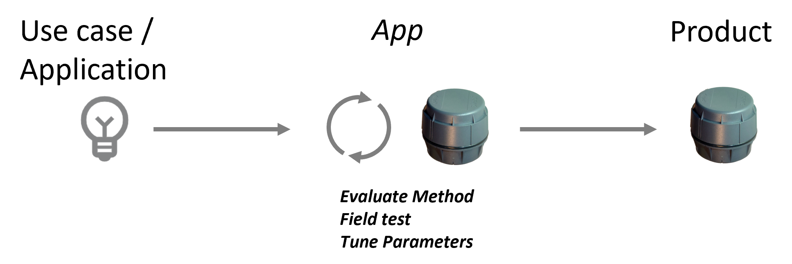
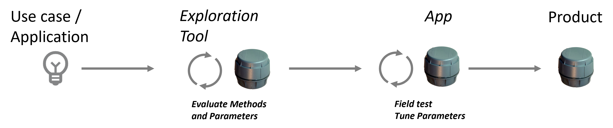

# XM126 (A121) user manual

{ width="480" }

!!! info "Firmware version TBD"
    This manual describes the R-IoT firmware for the XM126 module, built on the Acconeer A121 radar.

## 1. Introduction

R-IoT is an exceptionally versatile, compact, ultra-low-power radar
sensor designed to deliver reliable presence, distance, and level
measurements over many years of unattended operation.
By combining 60 GHz radar technology with Bluetooth Low Energy
communication and a robust mechanical design, R-IoT enables scalable
sensing solutions in both indoor and outdoor environments.

**This document targets advanced users** who require deeper insight into
how R-IoT operates and how it can be integrated into custom systems.
It complements the customer-facing installation manual by **focusing on
technical configuration concepts, radar behavior, and data integration**.

## 2. SWEiot Toolbox App

The R-IoT device radar unit can be configured using the SWEiot
Toolbox App available on Android. The app guides the user through
selecting a radar method and adjusting high-level parameters. To configure
R-IoT, you need:

- An Android device with Bluetooth Low Energy support
- The SWEiot Toolbox App installed (may be downloaded from Google Play)

For a short description of the SWEiot Toolbox:
<https://sweiot.gitbook.io/sweiot-docs/sweiot-toolbox-app/quick-start>.

## 3. System configuration

In addition to the settings available in the user interface of the
SWEiot Toolbox App and the "Commands and Logs" option in the main menu
it is also possible to send commands via the Open
API to the sensor when connected via a SWEiot gateway. Normally the 
SWEiot Admin tool offer all configuration options needed in this case.
Please note that this is for advanced users only — setting the wrong
parameters may cause the radar sensor to malfunction.

This chapter describes what the device-level system settings control,
the command interface, and the full system parameter reference. These
settings are shared by all measurement methods — per-method tuning is
documented in the method chapters.

### 3.1 What the system settings controls

The firmware runs one **measurement method** at a time (selected by
`curr_method`). A sample timer wakes the device every `sampl_int_s`
seconds (the interval belongs to the *method* configuration); 

Each wake-up:

- **Measures** — the current method executes, producing a result
   (distance, amplitude, occupancy, state, battery …). If the device is
   inactive (`active = 0`) no measurement is made.
- **Reports over BLE** — if the BLE transport is enabled, the result is
   packed into the Major/Minor fields of an **iBeacon advertisement**
   (UUID `bd79ca11-0bfa-41f4-a334-bf3ab66bb8XX`, last byte device-specific)
   and advertised for `adv_timeout_s` seconds at `adv_int_ms` interval.
   While advertising, the device is connectable and accepts commands over
   the Nordic UART Service.

In addition, independent timers can produce **periodic advertisements**
between measurements (`per_adv_s`) so the device stays visible/reachable
during long sampling intervals.

Settings are written as one comma-separated string with the `sys:` command,
persisted in flash, and survive reboot and DFU. A `factory` command clears
them (and all method settings) back to the compiled defaults below.

### 3.2 Commands

To communicate with the R-IoT unit, use the commands in the tables
below.

Commands are text strings sent over BLE (Nordic UART Service, while the
device advertises/is connected). Syntax:

* `name?` or `name` — query.
* `name:<data>` — set / execute.

All commands will return a string in which the first position indicates
whether the operation was successful or not. A `=` means success and `*`
means error. After the first position the command is echoed, followed by
possible further messages. In the case of `sys` and method settings
commands, the actual settings will be in this part. When a public key is
installed, commands must be suffixed with `#<hex signature>`.

### 3.3 System parameter reference

Supplying more than 15 fields, an invalid method number, or `transport = 0`
rejects the whole string and restores the previous configuration
(response `*sys:Invalid config`).

#### 3.3.1 Method selection and activation

| # | Parameter       | Default | Min | Max | Unit | Effect |
|-----|--------------------|---------|-------|-------|-------|---------------------------------------------|
| 1 | Selected Method | 0       | 0   | 16  | –    | Index of the active measurement method: **0** Idle, **1** Sparse IQ, **2** Distance, **3** Presence, **4** Speed, **5** Breathing, **6** Parking, **7** Smart Presence, **8** Tank Level, **9** Touchless Button, **10** Cargo, **11** Hand Motion, **12** Obstacle, **13** Phase Tracking, **14** Surface Velocity, **15** Vibration, **16** Waste Level. Changing it stops the previous method and initialises the new one. An invalid index rejects the configuration. |
| 6 | Radar on        | 0       | 0   | 1   | –    | **0 = inactive**: no measurements are made — each timer tick still advertises so the device stays configurable. **1 = active**: normal measuring. New devices ship inactive — set to 1 to start measuring. |
| 8 | Send on change  | 0       | 0   | 1   | –    | **0** = transmit every measurement result. **1** = transmit only results the method flags as changed. Reduces radio traffic and power; makes the device silent while nothing happens. |

#### 3.3.2 BLE advertising

| #  | Parameter                   | Default | Min | Max   | Unit | Effect |
|-----|--------------------|---------|-------|-------|-------|---------------------------------------------|
| 2  | Advertisement Interval (ms) | 250     | 25  | 10000 | ms   | Interval between advertisement packets while advertising. Lower → scanner picks the beacon up faster, higher power. Keep within 25–10000 ms (the firmware caps at 10000). |
| 3  | Advertisement timeout (s)   | 4       | 1   | 3600  | s    | How long the device advertises after each measurement. This is also the window in which a BLE central can connect and send commands. Longer → easier to catch/connect, higher power. |
| 4  | Bluetooth mode              | 0       | 0   | 2     | –    | PHY selection: **0** = normal (1M) only, **1** = alternate normal / long-range on successive advertisements, **2** = long-range (coded PHY) only. Long range roughly quadruples reach but is invisible to scanners without BLE 5 coded-PHY support (most phones). Periodic/NFC advertisements always use the normal PHY. |
| 5  | Tx power                    | 8       | -40 | 8     | dBm  | Radio transmit power (nRF52 steps, −40 … +8). 8 = maximum range; lower to save power or limit reach. |
| 15 | Advertisement format        | 0       | 0   | 1     | –    | Payload format of the advertisement: **0** = iBeacon (values bit-packed into the Major/Minor fields), **non-zero** = extended manufacturer-specific message carrying the values at full resolution. See *Payload content* above for the byte layout of each. |

#### 3.3.3 Periodic and NFC advertisements

| #  | Parameter                     | Default | Min | Max   | Unit | Effect |
|-----|--------------------|---------|-------|-------|-------|---------------------------------------------|
| 9  | Periodic advertisment         | 0       | 0   | 86400 | s    | Extra advertisement every N seconds *between* measurements, repeating the last result. **0 = off.** Only active when shorter than the current method's sampling interval. Use with long sampling intervals to keep the device findable/connectable. |
| 10 | Periodic advertisment timeout | 10      | 1   | 3600  | s    | Advertising duration of each periodic advertisement. |
| 11 | NFC advertisement timeout     | 20      | –   | –     | s    | Not used on R-IoT (BLE) devices — leave at the default. |

#### 3.3.4 Transport and reserved fields

| #  | Parameter                                    | Default | Min | Max | Unit | Effect |
|-----|--------------------|---------|-------|-------|-------|---------------------------------------------|
| 7  | Network configuration                        | 1       | 1   | 3   | –    | Radio transport selection. **Leave at 1 (BLE) on R-IoT devices.** 0 is rejected; setting 2 (LoRa only) stops all BLE reporting and makes the device unreachable over the air. |
| 12 | Secure Mode via Lora                         | 0       | –   | –   | –    | Reserved (LoRa devices only) — leave at 0. Note that BLE commands always require a signature whenever a public key is installed with `key:`. |
| 13 | Distance in mm for Lora                      | 0       | –   | –   | –    | Reserved (LoRa devices only) — leave at 0. |
| 14 | Parameter change confirmation sent over Lora | 60      | –   | –   | min  | Reserved (LoRa devices only) — leave at the default. |

## 4. Radar methods

Several predefined methods for operating the radar and analyzing the
results are included as standard in R-IoT. Each method can be
configured for different use case specifics. Each radar method uses
different measurement techniques that are further described below. The
following sections also give an overview of available methods for this
firmware version.

### 4.1 Method overview

The XM126 firmware contains all radar applications of the Acconeer
Exploration Tool as selectable methods. Parameter names and default
values follow the Exploration Tool, so a configuration developed there
can be transferred directly. The methods are selected with the first
system parameter (see *System configuration*) and are described in
detail in one chapter each:

| Method | Name             | Application |
|--------|------------------|--------------------------------------------------------------------|
| 0      | Idle             | No measurements; the device only advertises and stays configurable |
| 1      | Sparse IQ        | Raw radar service: strongest reflection of the configured range |
| 2      | Distance         | Distance to objects (distance detector) |
| 3      | Presence         | Motion detection of persons and objects |
| 4      | Speed            | Radial speed of moving objects |
| 5      | Breathing        | Breathing rate of a stationary person |
| 6      | Parking          | Car parked detection with optional obstruction detection |
| 7      | Smart Presence   | Presence divided into distance zones with wake-up mode |
| 8      | Tank Level       | Liquid level in tanks (small/medium/large presets) |
| 9      | Touchless Button | Contactless button: gestures close to the sensor |
| 10     | Cargo            | Container utilization level and intrusion presence |
| 11     | Hand Motion      | Hand motion at e.g. a faucet, with low-power wake up |
| 12     | Obstacle         | Obstacles and their speed relative a moving platform |
| 13     | Phase Tracking   | Micrometer-scale motion tracking |
| 14     | Surface Velocity | Surface speed of e.g. flowing water |
| 15     | Vibration        | Vibration frequency and displacement |
| 16     | Waste Level      | Fill level of waste bins |

Bilateration from the Exploration Tool is not available: it requires two
A121 sensors and the XM126 module only has one.

New devices ship with method 0 (Idle) selected and measurements
deactivated; select a method and set the `active` system parameter to 1
to start measuring.

### 4.2 Customizable radar settings

Every measurement environment is unique, bringing its own set of
challenges such as physical obstacles, weather conditions, or background
noise. To ensure high accuracy and reliable data, the R-IoT sensor
features a variety of customizable settings. These parameters allow you
to fine-tune how the radar perceives its surroundings, filters out
interference, and detects targets. By understanding and adjusting these
settings, you can optimize both the precision and the energy efficiency
of the device for your specific use case.

### 4.3 Usage

Turning a use case into a working product is a matter of choosing the
radar method that fits the application and tuning its parameters in the
real environment. There are two ways to get there.

**With the SWEiot Toolbox App only.** Connect to the R-IoT device
over Bluetooth, select a method, install the device where it will be
used and evaluate the results in the app. Adjust the parameters until the
readings are stable in the field, then roll the same settings out to the
production devices. This is the normal path when one of the standard
methods fits the application as it is.

<figure markdown="span">
  
  <figcaption>Figure 1. Method evaluation and tuning with the SWEiot Toolbox App only.</figcaption>
</figure>
**With the Acconeer Exploration Tool first.** The XM126 firmware
contains the radar applications of the Acconeer Exploration Tool, with the
same parameter names and default values. The Exploration Tool runs on a PC
connected to an Acconeer evaluation kit and shows the raw radar data and
the output of every method live, with plots and full control of all
parameters. This makes it the better place to compare methods and to find a
working parameter set for a new or demanding use case, before any device is
installed. The configuration found there is then entered in the SWEiot
Toolbox App, field tested on the R-IoT device and fine-tuned as
above. Instructions for installing the Exploration Tool and connecting an
evaluation kit are in Acconeer's *Setting Up and Running Exploration Tool*
guide:
<https://docs.acconeer.com/en/latest/getting_started/setting_up_and_running_et.html>.

<figure markdown="span">
  
  <figcaption>Figure 2. Method evaluation in the Acconeer Exploration Tool, followed by field tuning with the SWEiot Toolbox App.</figcaption>
</figure>
### 4.4 Method 1 — Sparse IQ

Measurement method for the R-IoT sensor (XM126, A121 radar).

The raw radar service of the A121 sensor. Measures complex (amplitude and phase) sparse IQ data points over the configured range and reports the distance and amplitude of the strongest reflection. This is the most flexible method: all radar parameters are exposed directly.

The algorithm is the Sparse IQ service from Acconeer's Exploration Tool and
SDK. Acconeer's own description of it — including the meaning of
every parameter below — is in their
[Interpreting radar data](https://docs.acconeer.com/en/latest/radar_data_and_control/a121/interpreting_radar_data.html) documentation.

#### 4.4.1 What the method does

The raw radar service of the A121 sensor. Measures complex (amplitude and phase) sparse IQ data points over the configured range and reports the distance and amplitude of the strongest reflection. This is the most flexible method: all radar parameters are exposed directly.

#### 4.4.2 Result

The measurement result is advertised in the beacon major/minor fields as
described in the *Payload content* chapter.

#### 4.4.3 Parameter reference

Parameters are sent as one comma-separated string, in this exact order.
Default string (compiled-in values when no configuration is present):

```
10,80,160,1,3,8,16,1,0,0,0,1,0
```

| #  | Parameter                    | Default | Min | Max   | Unit | Effect |
|-----|--------------------|---------|-------|-------|-------|---------------------------------------------|
| 1  | Measurement cycle (s)        | 10      | 1   | 86400 | –    | Interval in seconds between measurements. After each measurement the sensor is powered down until the next one, so this is the main power/latency trade-off. |
| 2  | Start point                  | 80      | –   | –     | –    | Starting point of the sweep The starting point of the sweep. The corresponding start in millimeter is approximately ``start_point`` * 2.5 mm. |
| 3  | Number of points             | 160     | –   | –     | –    | Number of data points to measure The number of data points to measure in a sweep. |
| 4  | Step length (in unit 2.5 mm) | 1       | –   | –     | –    | Step length in a sweep This sets the number of steps to have between each data point. The corresponding distance between each data point is ``step_length`` * 2.5 mm. |
| 5  | Profile                      | 3       | –   | –     | –    | Profile Each profile consists of a number of settings for the sensor that configures the RX and TX paths. Lower profiles have higher depth resolution while higher profiles have higher radar loop gain. |
| 6  | HWAAS                        | 8       | –   | –     | –    | Hardware accelerated average samples (HWAAS) Each data point can be sampled several times and the sensor hardware then produces an average value of those samples. The time needed to measure a sweep is roughly proportional to the number of averaged samples. Hence, if there is a need to obtain a higher update rate, HWAAS could be decreased but this leads to lower SNR. HWAAS must be between 1 and 511 inclusive. |
| 7  | Receiver gain                | 16      | –   | –     | –    | Receiver gain setting Must be a value between 0 and 23 inclusive where 23 is the highest gain and 0 the lowest. Lower gain gives higher SNR. However, too low gain may result in quantization, lowering SNR. Too high gain may result in saturation, corrupting the data. |
| 8  | Sweeps per frame             | 1       | –   | –     | –    | Number of sweeps per frame. Each frame consists of this number of consecutive sweeps of the configured range. |
| 9  | Sweep rate (Hz)              | 0       | –   | –     | Hz   | Sweep rate in Hz, the rate at which sweeps are performed within a frame. 0 = as fast as possible. |
| 10 | Frame rate (Hz)              | 0       | –   | –     | Hz   | Frame rate in Hz. 0 = as fast as possible (the sampling interval decides when frames are measured). |
| 11 | Phase enhancement            | 0       | –   | –     | –    | Enable or disable phase enhancement If enabled, the data phase will be enhanced such that coherent distance filtering can be applied. Given a single reflection from an object, the phase will appear as 'flat' around the amplitude peak. Enabling the phase enhancement increases the processing execution time. |
| 12 | PRF                          | 1       | –   | –     | –    | Pulse repetition frequency: 0 = 19.5 MHz, 1 = 15.6 MHz, 2 = 13.0 MHz, 3 = 8.7 MHz, 4 = 6.5 MHz, 5 = 5.2 MHz. Lower PRF gives longer maximum unambiguous range. |
| 13 | Amplitude method             | 0       | –   | –     | –    | How the amplitude of a depth point is calculated from the sweeps of the frame: 0 = coherent (amplitude of the mean IQ value), 1 = noncoherent (mean of the amplitudes). Encoding follows the Exploration Tool (2 = FFT max is not supported and falls back to noncoherent). |

### 4.5 Method 2 — Distance

Measurement method for the R-IoT sensor (XM126, A121 radar).

Measures the distance to objects in front of the sensor using the Acconeer distance detector. Reports the distances and reflective strengths of detected objects, strongest or closest first. Suitable for tank level, distance monitoring and similar measuring applications.

The algorithm is the distance detector from Acconeer's Exploration Tool and
SDK. Acconeer's own description of it — including the meaning of
every parameter below — is in their
[Distance Detector](https://docs.acconeer.com/en/latest/detectors/a121/distance_detector.html) documentation.

#### 4.5.1 What the method does

Measures the distance to objects in front of the sensor. Every
measurement cycle — once every `sampl_int_s` seconds — the method:

1. **Calibrates when needed.** The first measurement after a restart
   calibrates the sensor and the detector. After that the detector
   reports when the calibration has drifted (mostly with temperature)
   and the calibration is redone automatically, without losing the
   configuration.
2. **Sweeps the range** from *Range start* to *Range end*. The radar
   profile and the distance between measured points are chosen
   automatically from *Signal quality*, capped by *Max profile* and
   *Max step length*.
3. **Applies the threshold** selected by *Threshold method* and picks
   out every peak above it. Each peak has a distance and a reflector
   strength.
4. **Sorts the peaks** as *Peak sorting method* says — strongest first
   by default, closest first if that suits the installation better —
   and keeps up to ten of them.
5. **Reports the first peak** in the advertisement and goes back to
   sleep until the next cycle.

Measuring closer than about 100 mm is only possible with *Close range
leakage cancellation* enabled, and that calibration has to run with the
sensor already mounted in its final position.

The method suits tank and silo levels, snow and water levels, and any
application where the distance to one dominating object matters. For a
liquid surface, set *Reflector shape* to planar so the reported strength
is calculated for a flat reflector.

#### 4.5.2 Result

The advertised payload is the one described in the *Payload content*
section of the *System configuration* chapter. This method fills it in
as follows:

| Field                | This method reports |
|----------------------|------------------------------------------------------------------------|
| Distance             | Distance to the **first peak after sorting**, in millimetres. 0 when nothing was above the threshold. |
| Amplitude            | Reflector strength of that peak. Negative strengths are reported as 0. In the iBeacon payload the value saturates at the 9 bits available. |
| Occupied             | 1 when at least one peak was found, 0 when the range was empty. |
| Temperature, battery | The device values, as for every method. |

Up to **ten** peaks are kept internally. The full list — distance and
strength for each — and the raw amplitude sweep behind it are available
over the `meth_cmd` query commands, not in the advertisement.

Note that *Occupied* here means "something was detected in the range",
not "a person is present"; use *Presence* (method 3) for that.

#### 4.5.3 Parameter reference

Parameters are sent as one comma-separated string, in this exact order.
Default string (compiled-in values when no configuration is present):

```
10,0.25,3.0,0,5,0,15.0,3,1,0,100,100.0,0.0,0.5,50.0
```

| #  | Parameter                        | Default | Min | Max   | Unit | Effect |
|-----|--------------------|---------|-------|-------|-------|---------------------------------------------|
| 1  | Measurement cycle (s)            | 10      | 1   | 86400 | –    | Interval in seconds between measurements. After each measurement the sensor is powered down until the next one, so this is the main power/latency trade-off. |
| 2  | Range start (m)                  | 0.25    | 0   | 20    | m    | Start of the measurement range in meters. Reflections closer than this are not measured. |
| 3  | Range end (m)                    | 3.0     | 0   | 20    | m    | End of the measurement range in meters. A longer range means a longer measurement and more power; keep it just beyond the farthest object of interest. |
| 4  | Max step length                  | 0       | 0   | –     | –    | Upper limit on the distance between measured points. 0 = automatic, calculated from the profile. A shorter step length improves SNR through more efficient distance filtering, at the cost of measurement time and processing load. |
| 5  | Max profile                      | 5       | 1   | 5     | –    | Longest allowed radar profile, 1-5. A lower profile improves the radial resolution; a higher profile gives more signal (SNR) but more direct leakage close to the sensor. The detector picks the highest profile that does not interfere with the leakage. |
| 6  | Close range leakage cancellation | 0       | 0   | 1     | –    | 1 = characterise the sensor's direct leakage during calibration and subtract it from every sweep, which is what makes measurements closer than 100 mm possible. Requires the sensor to be mounted in its final geometry with free space in front of it when the calibration runs. 0 = off. |
| 7  | Signal quality (dB)              | 15.0    | -10 | 35    | dB   | Requested signal quality. Higher quality raises HWAAS and the SNR, and costs measurement time and power. |
| 8  | Threshold method                 | 3       | 0   | 3     | –    | How the detection threshold is formed: 0 = fixed amplitude, 1 = fixed strength, 2 = recorded (measured background), 3 = CFAR (constant false alarm rate, the default). CFAR adapts to the surroundings and needs no calibration sweep. |
| 9  | Peak sorting method              | 1       | 0   | 1     | –    | Order the detected distances are reported in: 0 = closest first, 1 = strongest first. The first peak is the one reported in the advertisement. |
| 10 | Reflector shape                  | 0       | 0   | 1     | –    | Shape assumed when converting amplitude to reflector strength: 0 = generic, 1 = planar (a flat surface such as a liquid level). |
| 11 | Frames in recorded threshold     | 100     | 1   | –     | –    | Number of frames collected when calibrating a recorded threshold (threshold method 2). Fewer frames calibrate faster, more frames give a statistically more reliable threshold. |
| 12 | Fixed amplitude threshold        | 100.0   | 0   | –     | –    | Threshold amplitude used when the threshold method is fixed amplitude (0). Lower = more sensitive. |
| 13 | Fixed strength threshold (dBsm)  | 0.0     | –   | –     | –    | Threshold reflector strength used when the threshold method is fixed strength (1). |
| 14 | Threshold sensitivity            | 0.5     | 0   | 1     | –    | Sensitivity of the CFAR and recorded thresholds. High sensitivity = low threshold (more detections, more false ones); low sensitivity = high threshold. |
| 15 | Update rate (Hz)                 | 50.0    | 1   | –     | Hz   | Rate the detector runs its sweeps at inside one measurement. |

#### 4.5.4 Tuning guide

* **Set the range first.** *Range start* and *Range end* should bracket
  only what you want to measure. A shorter range measures faster, uses
  less power and gives fewer false peaks.
* **Nothing is detected:** lower the threshold by raising *Threshold
  sensitivity*, or raise *Signal quality* to get more averaging and a
  better signal-to-noise ratio. Check that the object is not closer than
  100 mm without *Close range leakage cancellation*.
* **Detections that are not there:** lower *Threshold sensitivity*. If
  the false peaks always come from the same fixed object — a lid, a
  mounting bracket — switch *Threshold method* to recorded (2) and let
  the detector learn that background, or move *Range start* past it.
* **The wrong object is reported:** the advertisement carries the first
  peak only. Switch *Peak sorting method* to closest first (0) when the
  nearest object is the interesting one, or narrow the range so the
  competing reflection falls outside it.
* **Readings jump between two values:** two reflections of similar
  strength are swapping places. Narrow the range, or use closest-first
  sorting.
* **Battery life is too short:** lengthen *Measurement cycle*, and lower
  *Signal quality* — it is the parameter that decides how much averaging
  each measurement does.

### 4.6 Method 3 — Presence

Measurement method for the R-IoT sensor (XM126, A121 radar).

Detects motion of persons or objects in front of the sensor using the Acconeer presence detector. Fast motions (intra-frame) and slow motions such as breathing (inter-frame) are detected separately. Reports presence, the distance to the detected motion and the presence score.

The algorithm is the presence detector from Acconeer's Exploration Tool and
SDK. Acconeer's own description of it — including the meaning of
every parameter below — is in their
[Presence Detector](https://docs.acconeer.com/en/latest/detectors/a121/presence_detector.html) documentation.

#### 4.6.1 What the method does

Detects motion of persons or objects in front of the sensor using the Acconeer presence detector. Fast motions (intra-frame) and slow motions such as breathing (inter-frame) are detected separately. Reports presence, the distance to the detected motion and the presence score.

#### 4.6.2 Result

The measurement result is advertised in the beacon major/minor fields as
described in the *Payload content* chapter.

#### 4.6.3 Parameter reference

Parameters are sent as one comma-separated string, in this exact order.
Default string (compiled-in values when no configuration is present):

```
10,0.3,2.5,0,0,12.0,16,0,15.0,32,0,1,1.3,0.15,0.3,1,1.0,6.0,0.2,0.5,2.0,3,5
```

| #  | Parameter                                      | Default | Min   | Max   | Unit | Effect |
|-----|--------------------|---------|-------|-------|-------|---------------------------------------------|
| 1  | Measurement cycle (s)                          | 10      | 1     | 86400 | –    | Interval in seconds between measurements. After each measurement the sensor is powered down until the next one, so this is the main power/latency trade-off. |
| 2  | Range start (m)                                | 0.3     | 0     | 20    | m    | Start of the measurement range in meters. Reflections closer than this are not measured. |
| 3  | Range end (m)                                  | 2.5     | 0     | 20    | m    | End of the measurement range in meters. A longer range means a longer measurement and more power; keep it just beyond the farthest object of interest. |
| 4  | Profile                                        | 0       | –     | –     | –    | Sets the profile. If no argument is provided, the highest possible profile without interference of direct leakage is used to maximize SNR. |
| 5  | Step length (in unit 2.5 mm)                   | 0       | 1     | –     | –    | Step length in points. If no argument is provided, the step length is automatically calculated based on the profile. |
| 6  | Frame rate (Hz)                                | 12.0    | 0.1   | 100   | Hz   | Frame rate in Hz. |
| 7  | Sweeps per frame                               | 16      | 1     | 4095  | –    | Number of sweeps per frame. |
| 8  | Enable automatic subsweep config (recommended) | 0       | –     | –     | –    | Automatically select subsweeps and configure HWAAS. |
| 9  | Signal quality                                 | 15.0    | -10.0 | 60.0  | dB   | Signal quality measurement (higher = better signal, lower = less power consumption). |
| 10 | HWAAS                                          | 32      | 1     | 511   | –    | Number of HWAAS. |
| 11 | Inter frame idle state                         | 0       | –     | –     | –    | Sets the inter frame idle state. |
| 12 | Enable intra (fast) motion detection           | 1       | –     | –     | –    | Enables the intra-frame presence detection used for detecting faster movements inside frames. |
| 13 | Intra detection threshold                      | 1.3     | 0     | 100   | –    | Detection threshold for the intra-frame presence detection. |
| 14 | Intra time constant                            | 0.15    | 0     | 1     | s    | Time constant for the depthwise filtering in the intra-frame part. |
| 15 | Intra output time constant                     | 0.3     | 0.01  | 20    | s    | Time constant for the output in the intra-frame part. |
| 16 | Enable inter (slow) motion detection           | 1       | –     | –     | –    | Enables the inter-frame presence detection used for detecting slower movements between frames. |
| 17 | Inter detection threshold                      | 1.0     | 0     | 100   | –    | Detection threshold for the inter-frame presence detection. |
| 18 | Inter fast cutoff freq. (Hz)                   | 6.0     | 1     | 50    | Hz   | Cutoff frequency of the low pass filter for the fast filtered absolute sweep mean. No filtering is applied if the cutoff is set over half the frame rate (Nyquist limit). |
| 19 | Inter slow cutoff freq. (Hz)                   | 0.2     | 0.01  | 1     | Hz   | Cutoff frequency of the low pass filter for the slow filtered absolute sweep mean. |
| 20 | Inter time constant                            | 0.5     | 0.01  | 20    | s    | Time constant of the low pass filter for the inter-frame deviation between fast and slow. |
| 21 | Inter output time constant                     | 2.0     | 0.01  | 20    | s    | Time constant for the output in the inter-frame part. |
| 22 | Presence timeout                               | 3       | 1     | 30    | s    | Number of seconds the inter-frame presence score needs to decrease before exponential scaling starts for faster decline. |
| 23 | Measure time (s)                               | 5       | –     | –     | –    | Firmware specific: length in seconds of the measurement burst that is run at every sampling interval. Longer bursts give more settled results but use more power. |

### 4.7 Method 4 — Speed

Measurement method for the R-IoT sensor (XM126, A121 radar).

Measures the radial speed of moving objects using the doppler spectrum of the radar signal at one or more depths. Reports the dominant speed. Ported from the Exploration Tool speed detector.

The algorithm is the speed detector from Acconeer's Exploration Tool and
SDK. Acconeer's own description of it — including the meaning of
every parameter below — is in their
[Speed Detector](https://docs.acconeer.com/en/latest/detectors/a121/speed_detector.html) documentation.

#### 4.7.1 What the method does

Measures the radial speed of moving objects using the doppler spectrum of the radar signal at one or more depths. Reports the dominant speed. Ported from the Exploration Tool speed detector.

#### 4.7.2 Result

The measurement result is advertised in the beacon major/minor fields as
described in the *Payload content* chapter.

#### 4.7.3 Parameter reference

Parameters are sent as one comma-separated string, in this exact order.
Default string (compiled-in values when no configuration is present):

```
10,200,1,0,0,0,50,0,0,10.0,100.0
```

| #  | Parameter                    | Default | Min | Max     | Unit | Effect |
|-----|--------------------|---------|-------|-------|-------|---------------------------------------------|
| 1  | Measurement cycle (s)        | 10      | 1   | 86400   | –    | Interval in seconds between measurements. After each measurement the sensor is powered down until the next one, so this is the main power/latency trade-off. |
| 2  | Start point (Hz)             | 200     | –   | –       | –    | Start point of measurement interval. |
| 3  | Number of points             | 1       | 1   | 100     | –    | Number of points to measure. |
| 4  | Step length (in unit 2.5 mm) | 0       | 1   | –       | –    | Step length between points. |
| 5  | Profile                      | 0       | –   | –       | –    | Sets the profile. If no argument is provided, the highest possible profile without interference of direct leakage is used to maximize SNR. |
| 6  | Frame rate (Hz)              | 0       | 1   | 200     | Hz   | Frame rate in Hz. |
| 7  | Number of bins (m/s)         | 50      | 3   | 4095    | –    | Determines the resolution in m/s by max_speed/num_bins. |
| 8  | Sweep rate (Hz)              | 0       | 1   | 134000  | Hz   | Sweep rate in Hz. |
| 9  | HWAAS                        | 0       | 1   | 511     | –    | Number of HWAAS. |
| 10 | Max speed (m/s)              | 10.0    | 0   | 150.0   | m    | Max detectable speed in m/s. |
| 11 | Threshold                    | 100.0   | 1.0 | 10000.0 | –    | Peak relative height to median scaled PSD. E.g., 10.0 indicates that we need to have 10 times the median value to trigger. |

### 4.8 Method 5 — Breathing

Measurement method for the R-IoT sensor (XM126, A121 radar).

Estimates the breathing rate of a stationary person. The method first finds the person with a presence detector, determines the optimal measurement distance and then estimates the breathing rate from millimeter-scale chest motion. Reports the breathing rate in breaths per minute.

The algorithm is the breathing reference application from Acconeer's Exploration Tool and
SDK. Acconeer's own description of it — including the meaning of
every parameter below — is in their
[Breathing Reference Application](https://docs.acconeer.com/en/latest/ref_apps/a121/breathing.html) documentation.

#### 4.8.1 What the method does

Estimates the breathing rate of a stationary person. The method first finds the person with a presence detector, determines the optimal measurement distance and then estimates the breathing rate from millimeter-scale chest motion. Reports the breathing rate in breaths per minute.

#### 4.8.2 Result

The measurement result is advertised in the beacon major/minor fields as
described in the *Payload content* chapter.

#### 4.8.3 Parameter reference

Parameters are sent as one comma-separated string, in this exact order.
Default string (compiled-in values when no configuration is present):

```
60,0.3,1.5,1,3,5.0,32,3,20.0,16,6.0,60.0,20.0,120
```

| #  | Parameter                                    | Default | Min | Max   | Unit | Effect |
|-----|--------------------|---------|-------|-------|-------|---------------------------------------------|
| 1  | Measurement cycle (s)                        | 60      | 1   | 86400 | –    | Interval in seconds between measurements. After each measurement the sensor is powered down until the next one, so this is the main power/latency trade-off. |
| 2  | Range start (m)                              | 0.3     | 0   | 20    | m    | Start of the measurement range in meters. Reflections closer than this are not measured. |
| 3  | Range end (m)                                | 1.5     | 0   | 20    | m    | End of the measurement range in meters. A longer range means a longer measurement and more power; keep it just beyond the farthest object of interest. |
| 4  | Use presence processor to determine distance | 1       | –   | –     | –    | If True, use the presence processor to determine distance to subject. |
| 5  | Number of distances to analyze               | 3       | 1   | 64    | –    | Indicates the number of distance to analyzed, centered around the distance where presence is detected. |
| 6  | Duration to determine distance               | 5.0     | 1   | –     | s    | Time for the presence processor to determine distance to presence. |
| 7  | HWAAS                                        | 32      | 1   | 511   | –    | HWAAS. |
| 8  | Profile                                      | 3       | –   | –     | –    | Profile. |
| 9  | Frame rate (Hz)                              | 20.0    | –   | –     | Hz   | Frame rate. |
| 10 | Sweeps per frame                             | 16      | 1   | 64    | –    | Sweeps per frame. |
| 11 | Lowest anticipated breathing rate (bpm)      | 6.0     | 2   | –     | bpm  | Lowest anticipated breathing rate (breaths per minute). |
| 12 | Highest anticipated breathing rate (bpm)     | 60.0    | 2   | –     | bpm  | Highest anticipated breathing rate (breaths per minute). |
| 13 | Time series length                           | 20.0    | –   | –     | s    | Time series length (s). |
| 14 | Max measure time (s)                         | 120     | –   | –     | –    | Firmware specific: upper bound in seconds of one measurement run. If no result is produced within this time the measurement is aborted and the previous result is kept. |

### 4.9 Method 6 — Parking

Measurement method for the R-IoT sensor (XM126, A121 radar).

Detects whether a car is parked above or in front of the sensor, using amplitude signatures over multiple samples. An optional obstruction detection detects if the sensor is covered. Reports car detected and obstruction detected.

The algorithm is the parking reference application from Acconeer's Exploration Tool and
SDK. Acconeer's own description of it — including the meaning of
every parameter below — is in their
[Parking Reference Application](https://docs.acconeer.com/en/latest/ref_apps/a121/parking.html) documentation.

#### 4.9.1 What the method does

Detects whether a car is parked above or in front of the sensor, using amplitude signatures over multiple samples. An optional obstruction detection detects if the sensor is covered. Reports car detected and obstruction detected.

#### 4.9.2 Result

The measurement result is advertised in the beacon major/minor fields as
described in the *Payload content* chapter.

#### 4.9.3 Parameter reference

Parameters are sent as one comma-separated string, in this exact order.
Default string (compiled-in values when no configuration is present):

```
10,0.3,1.5,32,2,10.0,5,15.0,0.1,60.0,0,0.06,0.03,0.05
```

| #  | Parameter                          | Default | Min   | Max   | Unit | Effect |
|-----|--------------------|---------|-------|-------|-------|---------------------------------------------|
| 1  | Measurement cycle (s)              | 10      | 1     | 86400 | –    | Interval in seconds between measurements. After each measurement the sensor is powered down until the next one, so this is the main power/latency trade-off. |
| 2  | Range start (m)                    | 0.3     | 0     | 20    | m    | Start of the measurement range in meters. Reflections closer than this are not measured. |
| 3  | Range end (m)                      | 1.5     | 0     | 20    | m    | End of the measurement range in meters. A longer range means a longer measurement and more power; keep it just beyond the farthest object of interest. |
| 4  | HWAAS                              | 32      | 1     | 511   | –    | HWAAS. This parameter has an impact on the overall signal to noise ratio (SNR), low values will yield a noisy signal and poorer performance, since the signature will vary more due to noise variations. |
| 5  | Profile                            | 2       | –     | –     | –    | Profile. This parameter determines the length of the pulse. If the range is within the so called 'direct leakage', the performance of the algorithm will deteriorate. For close ranges (i.e. ground mounted applications), it is recommended to use profile 1 or 2. For longer ranges, higher profiles should be used. The limitations that the range puts on profile choices is implemented in the Exploration tool GUI and can be experimented with there. |
| 6  | Update rate (Hz)                   | 10.0    | –     | –     | Hz   | Update rate. |
| 7  | Queue length                       | 5       | 1     | 200   | –    | Number of consecutive samples stored. |
| 8  | Amplitude threshold                | 15.0    | 1.0   | 20.0  | –    | Threshold level in times the noise level to trigger. |
| 9  | Weighted distance threshold (m)    | 0.1     | 0.0   | –     | m    | Threshold in m between weighted distance points to consider them similar. |
| 10 | Signature similarity threshold (%) | 60.0    | 0     | 100.0 | –    | How large fraction of the signature history that has to be similar in order to retain detection. |
| 11 | Enable obstruction detection       | 0       | –     | –     | –    | If obstruction detection should be active. This costs some extra battery power. |
| 12 | Obstruction distance threshold     | 0.06    | 0.001 | 1.0   | –    | Determines how large fraction of each dimension the obstruction measurement can vary without considering the sensor obstructed. E.g. if the threshold is set to 0.06 and the range is between 0.02 m and 0.05 m. The weighted distance part of the signature can vary (0.05 m - 0.02 m) * 0.06 = 0.0018 m. |
| 13 | Range start (m)                    | 0.03    | 0.01  | –     | m    | Start of obstruction detection range. The detection range should not intersect with the detection range for the main functionality. |
| 14 | Range end (m)                      | 0.05    | 0.01  | –     | m    | End of obstruction detection range. The detection range should not intersect with the detection range for the main functionality. |

### 4.10 Method 7 — Smart Presence

Measurement method for the R-IoT sensor (XM126, A121 radar).

Presence detection divided into distance zones, with an optional low-power wake-up mode that switches to a more detailed nominal configuration once presence is detected. Reports presence, the zone of the strongest detection and a zone detection bitmask.

The algorithm is the smart presence reference application from Acconeer's Exploration Tool and
SDK. Acconeer's own description of it — including the meaning of
every parameter below — is in their
[Smart Presence Reference Application](https://docs.acconeer.com/en/latest/ref_apps/a121/smart_presence.html) documentation.

#### 4.10.1 What the method does

Presence detection divided into distance zones, with an optional low-power wake-up mode that switches to a more detailed nominal configuration once presence is detected. Reports presence, the zone of the strongest detection and a zone detection bitmask.

#### 4.10.2 Result

The measurement result is advertised in the beacon major/minor fields as
described in the *Payload content* chapter.

#### 4.10.3 Parameter reference

Parameters are sent as one comma-separated string, in this exact order.
Default string (compiled-in values when no configuration is present):

```
10,0.3,2.5,7,12.0,16,32,15.0,1.3,1.0,0,1,1,5
```

| #  | Parameter                 | Default | Min   | Max   | Unit | Effect |
|-----|--------------------|---------|-------|-------|-------|---------------------------------------------|
| 1  | Measurement cycle (s)     | 10      | 1     | 86400 | –    | Interval in seconds between measurements. After each measurement the sensor is powered down until the next one, so this is the main power/latency trade-off. |
| 2  | Range start (m)           | 0.3     | 0     | 20    | m    | Start of the measurement range in meters. Reflections closer than this are not measured. |
| 3  | Range end (m)             | 2.5     | 0     | 20    | m    | End of the measurement range in meters. A longer range means a longer measurement and more power; keep it just beyond the farthest object of interest. |
| 4  | Number of zones           | 7       | 1     | –     | –    | Maximum number of detection zones. |
| 5  | Frame rate (Hz)           | 12.0    | 0.1   | 100   | Hz   | Frame rate in Hz. |
| 6  | Sweeps per frame          | 16      | 1     | 4095  | –    | Number of sweeps per frame. |
| 7  | HWAAS                     | 32      | 1     | 511   | –    | Number of HWAAS. |
| 8  | Signal quality            | 15.0    | -10.0 | 60.0  | dB   | Signal quality measurement (higher = better signal, lower = less power consumption). |
| 9  | Intra detection threshold | 1.3     | 0     | 100   | –    | Detection threshold for the intra-frame presence detection. |
| 10 | Inter detection threshold | 1.0     | 0     | 100   | –    | Detection threshold for the inter-frame presence detection. |
| 11 | Show all detected zones   | 0       | –     | –     | –    | Visualize all detected zones in the circle sector. |
| 12 | Switch config on wake up  | 1       | –     | –     | –    | Switch between two configurations based on presence detection. |
| 13 | Num zones for wakeup      | 1       | –     | –     | –    | Number of detection zones used in the low power wake up configuration. |
| 14 | Measure time (s)          | 5       | –     | –     | –    | Firmware specific: length in seconds of the measurement burst that is run at every sampling interval. Longer bursts give more settled results but use more power. |

### 4.11 Method 8 — Tank Level

Measurement method for the R-IoT sensor (XM126, A121 radar).

Measures the liquid level in a tank with the distance detector, refined with median filtering over multiple measurements. Presets for small, medium and large tanks. Reports the level and its status.

The algorithm is the tank level reference application from Acconeer's Exploration Tool and
SDK. Acconeer's own description of it — including the meaning of
every parameter below — is in their
[Tank Level Reference Application](https://docs.acconeer.com/en/latest/ref_apps/a121/tank_level.html) documentation.

#### 4.11.1 What the method does

Measures the liquid level in a tank with the distance detector, refined with median filtering over multiple measurements. Presets for small, medium and large tanks. Reports the level and its status.

#### 4.11.2 Result

The measurement result is advertised in the beacon major/minor fields as
described in the *Payload content* chapter.

#### 4.11.3 Parameter reference

Parameters are sent as one comma-separated string, in this exact order.
Default string (compiled-in values when no configuration is present):

```
60,0.03,0.5,1,5,1,0,5,0,15.0,3,1,1,100,100.0,0.0,0.5
```

| #  | Parameter                               | Default | Min | Max   | Unit | Effect |
|-----|--------------------|---------|-------|-------|-------|---------------------------------------------|
| 1  | Measurement cycle (s)                   | 60      | 1   | 86400 | –    | Interval in seconds between measurements. After each measurement the sensor is powered down until the next one, so this is the main power/latency trade-off. |
| 2  | Range start (m)                         | 0.03    | 0   | 20    | m    | Start of the measurement range in meters. Reflections closer than this are not measured. |
| 3  | Range end (m)                           | 0.5     | 0   | 20    | m    | End of the measurement range in meters. A longer range means a longer measurement and more power; keep it just beyond the farthest object of interest. |
| 4  | Preset                                  | 1       | –   | –     | –    | Base preset for the tank dimensions: 1 = small tank (0.03-0.5 m), 2 = medium tank (0.05-6 m), 3 = large tank (0.1-15 m). The other parameters override the preset. |
| 5  | Median filter length                    | 5       | 1   | 10    | –    | Length of the median filter used to stabilize the level result. |
| 6  | Num measurements averaged               | 1       | 1   | 10    | –    | Number of median values averaged to obtain the level result. |
| 7  | Max step length                         | 0       | 1   | –     | –    | If set, limits the step length. If no argument is provided, the step length is automatically calculated based on the profile. Reducing the step length increases SNR through more efficient distance filtering, while increasing the measurement time and the processing load. |
| 8  | Max profile                             | 5       | –   | –     | –    | Specifies the longest allowed profile. If no argument is provided, the highest possible profile without interference of direct leakage is used to maximize SNR. A lower profile improves the radial resolution. |
| 9  | Enable close range leakage cancellation | 0       | –   | –     | –    | Enable close range leakage cancellation logic. Close range leakage cancellation refers to the process of measuring close to the sensor(<100mm) by first characterizing the direct leakage, and then subtracting it from the measured sweep in order to isolate the signal component of interest. The close range leakage cancellation process requires the sensor to be installed in its intended geometry with free space in front of the sensor during detector calibration. |
| 10 | Signal quality                          | 15.0    | –   | –     | dB   | Signal quality (dB). High quality equals higher HWAAS and better SNR but increases power consumption. |
| 11 | Threshold method                        | 3       | –   | –     | –    | Threshold method |
| 12 | Peak sorting method                     | 1       | –   | –     | –    | Sorting method of estimated distances. The distance estimates are sorted according to the selected strategy, before being return by th application. |
| 13 | Reflector shape                         | 1       | –   | –     | –    | Reflector shape. |
| 14 | Num frames in rec. thr.                 | 100     | –   | –     | –    | Number of frames used when calibrating threshold. A lower number reduce calibration time and a higher number results in a more statistically significant threshold. |
| 15 | Fixed amplitude threshold value         | 100.0   | –   | –     | –    | Value of fixed amplitude threshold. |
| 16 | Fixed strength threshold value (dBsm)   | 0.0     | –   | –     | –    | Value of fixed strength threshold. |
| 17 | Threshold sensitivity                   | 0.5     | –   | –     | –    | Sensitivity of threshold. High sensitivity equals low detection threshold, low sensitivity equals high detection threshold. |

### 4.12 Method 9 — Touchless Button

Measurement method for the R-IoT sensor (XM126, A121 radar).

Detects deliberate hand gestures very close to the sensor (approximately 0-5 cm in close range, 0-24 cm in far range) so the device can be used as a contactless button. Reports separate close-range and far-range detections.

The algorithm is the touchless button reference application from Acconeer's Exploration Tool and
SDK. Acconeer's own description of it — including the meaning of
every parameter below — is in their
[Touchless Button Reference Application](https://docs.acconeer.com/en/latest/ref_apps/a121/touchless_button.html) documentation.

#### 4.12.1 What the method does

Turns the sensor into a button that registers a hand without being
touched — useful behind a sealed or hygienic surface, where a mechanical
button would be a weak point.

The method works by comparing what it sees against a **calibrated
background**: it first learns what the empty scene looks like, then
reports a detection when something changes against it. That background
is re-learned every *Calibration interval*, so slow changes — a door
left open, condensation on the lens — do not accumulate into a false
detection.

Two detection zones can be used, and *Range* selects which:

| Range | Detects |
|-------|------------------------------------------------------|
| 0     | Close range only — a hand right at the surface |
| 1     | Far range only — a hand approaching from further out |
| 2     | Both zones, reported independently |

Each zone has its own *Sensitivity* and *Patience*. Sensitivity sets how
large a change counts as a detection; patience is how many frames in a
row must agree before the state flips, in both directions. Raising
patience removes twitchy detections at the cost of a slightly slower
button.

Every measurement cycle the method runs a burst of `measure_time_s`
seconds, so a hand passing during the burst is caught; between bursts
the sensor sleeps.

#### 4.12.2 Result

The advertised payload is the one described in the *Payload content*
section of the *System configuration* chapter. This method uses it
differently from the measuring methods:

| Field                | This method reports |
|----------------------|------------------------------------------------------------------------|
| Occupied             | 1 while either zone detects, 0 when neither does. |
| Amplitude            | **Which zone detected**, as a two-bit value: 0 = none, 1 = close range, 2 = far range, 3 = both. It is not an echo strength. |
| Distance             | Always 0 — the method reports a button state, not a distance. |
| Temperature, battery | The device values, as for every method. |

The result is flagged as *changed* only when the detection state
actually flips, so with *Send on change* enabled in the system settings
the device transmits on press and release and stays silent in between.

#### 4.12.3 Parameter reference

Parameters are sent as one comma-separated string, in this exact order.
Default string (compiled-in values when no configuration is present):

```
10,0,1.9,2,2.0,2,0.6,20.0,5
```

| # | Parameter                 | Default | Min | Max   | Unit | Effect |
|-----|--------------------|---------|-------|-------|-------|---------------------------------------------|
| 1 | Measurement cycle (s)     | 10      | 1   | 86400 | –    | Interval in seconds between measurements. After each measurement the sensor is powered down until the next one, so this is the main power/latency trade-off. |
| 2 | Range                     | 0       | –   | –     | –    | The measurement type. This decides which of the other parameters to take into consideration. ``CLOSE_RANGE`` will apply the close range parameters onto the sweep. ``FAR_RANGE`` will apply the far range parameters onto the sweep. ``CLOSE_AND_FAR_RANGE`` will apply the parameters for close range onto the first subsweep and the parameters for far range onto the second subsweep. |
| 3 | Sensitivity (close range) | 1.9     | 0.1 | 4     | –    | Sensitivity for close range detection. High sensitivity equals low detection threshold, low sensitivity equals high detection threshold. |
| 4 | Patience (close range)    | 2       | 0   | –     | –    | Number of frames in a row above threshold to count as a new close range detection, also number of frames in a row below threshold to count as end of detection. |
| 5 | Sensitivity (far range)   | 2.0     | 0.1 | 4     | –    | Sensitivity for far range detection. High sensitivity equals low detection threshold, low sensitivity equals high detection threshold. |
| 6 | Patience (far range)      | 2       | 0   | –     | –    | Number of frames in a row above threshold to count as a new far range detection, also number of frames in a row below threshold to count as end of detection. |
| 7 | Calibration duration (s)  | 0.6     | 0   | –     | s    | Length of the background calibration. The method learns what the empty scene looks like and detects changes against it; a longer calibration is more stable but the sensor must be undisturbed while it runs. |
| 8 | Calibration interval (s)  | 20.0    | 1   | –     | s    | Interval between calibrations in seconds. When reached a new calibration is made. Should not be set lower than the longest estimated continuous detection event. |
| 9 | Measure time (s)          | 5       | –   | –     | –    | Firmware specific: length in seconds of the measurement burst that is run at every sampling interval. Longer bursts give more settled results but use more power. |

#### 4.12.4 Tuning guide

* **Choose the range first.** Use close range for a button you touch
  the surface of, far range for a wave-to-open gesture, both when the
  two should be distinguished — the payload tells them apart.
* **Nothing registers:** raise the *Sensitivity* of the zone you are
  using, and check that the burst is long enough — a hand that arrives
  between two bursts is never seen. Lengthen *Measure time* or shorten
  *Measurement cycle*.
* **It triggers on its own:** lower the *Sensitivity*, and raise
  *Patience* so a single noisy frame cannot flip the state. If it
  drifts over minutes rather than seconds, shorten *Calibration
  interval* so the background is refreshed more often.
* **It reacts too slowly:** lower *Patience*. Each unit of patience
  costs one frame in both directions.
* **Detections stop working after the installation changes:** the
  background was calibrated against the old scene. It is re-learned at
  the next *Calibration interval*; shorten that interval, or restart
  the device to force a calibration immediately.
* **Battery life is too short:** this method keeps the radar running
  for the whole burst. *Measure time* and *Measurement cycle* are the
  two knobs that matter.

### 4.13 Method 10 — Cargo

Measurement method for the R-IoT sensor (XM126, A121 radar).

Monitors a cargo container: measures the utilization level (how full the container is) with the distance detector and/or detects presence (e.g. intruders or stowaways) inside the container. Reports the utilization level in percent and presence.

The algorithm is the cargo example application from Acconeer's Exploration Tool and
SDK. Acconeer's own description of it — including the meaning of
every parameter below — is in their
[Cargo](https://docs.acconeer.com/en/latest/example_apps/a121/cargo.html) documentation.

#### 4.13.1 What the method does

Monitors a shipping container or similar cargo space: **how full it is**
and **whether someone is inside**. The two halves run one after the other
and either can be switched off.

1. **Utilization level.** The method measures the distance to the cargo
   surface from the sensor at the container roof or door, and turns it
   into a percentage of the container's length. *Container size* sets
   that length — 10, 20 or 40 foot — and with it the detection range, so
   it must match the actual container for the percentage to mean
   anything.
2. **Presence.** After the level has been measured the method runs a
   presence burst of *Presence burst* seconds, looking for motion
   inside. It judges fast motion within a single frame (*Presence intra
   detection threshold*) and slow motion between frames (*Presence inter
   detection threshold*) — the latter is what catches a person who is
   still but breathing.

Between measurements the sensor sleeps, so the cost of a cycle is
essentially the level measurement plus the presence burst.

#### 4.13.2 Result

The advertised payload is the one described in the *Payload content*
section of the *System configuration* chapter. This method fills it in
as follows:

| Field                | This method reports |
|----------------------|------------------------------------------------------------------------|
| Distance             | Distance to the cargo surface, in millimetres. 0 when utilization level detection is switched off or no surface was found. |
| Amplitude            | The **utilization level in percent**, not an echo strength — 0 for an empty container, 100 for a full one. |
| Occupied             | 1 when presence was detected inside the container, 0 when not. With presence detection switched off it is always 0. |
| Temperature, battery | The device values, as for every method. |

So a single advertisement carries both answers at once: how full, in the
amplitude field, and whether anyone is inside, in the occupancy bit.

#### 4.13.3 Parameter reference

Parameters are sent as one comma-separated string, in this exact order.
Default string (compiled-in values when no configuration is present):

```
60,1,1,10.0,0.0,1,6.0,12,20.0,4.0,2.75,5
```

| #  | Parameter                          | Default | Min | Max   | Unit | Effect |
|-----|--------------------|---------|-------|-------|-------|---------------------------------------------|
| 1  | Measurement cycle (s)              | 60      | 1   | 86400 | –    | Interval in seconds between measurements. After each measurement the sensor is powered down until the next one, so this is the main power/latency trade-off. |
| 2  | Container size                     | 1       | –   | –     | –    | Container size. Sets the detection range for utilization level detection and for presence detection. |
| 3  | Activate utilization level         | 1       | –   | –     | –    | 1 = measure how full the container is. 0 = skip it and report presence only, which shortens each measurement. |
| 4  | Utilization signal quality         | 10.0    | -10 | 35    | dB   | Signal quality metric (higher = better signal, lower = less power consumption). |
| 5  | Utilization threshold sensitivity  | 0.0     | 0   | 1     | –    | Sensitivity of threshold. High sensitivity equals low detection threshold, low sensitivity equals high detection threshold. |
| 6  | Activate presence detection        | 1       | –   | –     | –    | 1 = also look for a person or animal inside the container after the level has been measured. 0 = level only. |
| 7  | Presence update rate               | 6.0     | 0.1 | –     | Hz   | Rate the presence detector runs at during its burst. Higher reacts faster to motion and uses more power. |
| 8  | Presence sweeps per frame          | 12      | 1   | 4095  | –    | Sweeps the presence detector collects per frame. More sweeps make slow motion easier to see, at the cost of measurement time. |
| 9  | Presence signal quality            | 20.0    | -10 | 35    | dB   | Signal quality metric (higher = better signal, lower = less power consumption). |
| 10 | Presence inter detection threshold | 4.0     | 1   | 20    | –    | Threshold for slow motion, judged between frames - a person breathing or shifting position. Lower detects more, and reacts more to draughts and vibration. |
| 11 | Presence intra detection threshold | 2.75    | 1   | 20    | –    | Threshold for fast motion, judged inside a single frame - someone moving about. Lower detects more, and is more easily triggered by noise. |
| 12 | Presence burst (s)                 | 5       | –   | –     | –    | Firmware specific: length in seconds of the presence detection burst that is run at every sampling interval. |

#### 4.13.4 Tuning guide

* **Set *Container size* to the real container.** Everything about the
  utilization percentage — the range measured and what 100 % means —
  follows from it.
* **The level reads 0 or jumps around:** cargo with an irregular surface
  scatters the echo. Raise *Utilization signal quality* for more
  averaging, and raise *Utilization threshold sensitivity* so weaker
  surfaces still cross the threshold.
* **An empty container does not read 0 %:** something inside the range
  is reflecting — a pallet, a door frame, the sensor's own mounting.
  Check the mounting position before changing thresholds.
* **Presence is missed:** a person sitting still is slow motion.
  Lower *Presence inter detection threshold* first, and lengthen
  *Presence burst* — a short burst can fall entirely between two
  movements. Raising *Presence sweeps per frame* also helps slow motion.
* **False presence:** raise both detection thresholds. Vibration while
  the container is moving is the usual cause, and the inter-frame
  detector is the sensitive one.
* **Battery life is too short:** switch off whichever half you do not
  need — *Activate utilization level* or *Activate presence detection* —
  and shorten *Presence burst*. The burst dominates, because the radar
  runs continuously throughout it. Then lengthen *Measurement cycle*.

### 4.14 Method 11 — Hand Motion

Measurement method for the R-IoT sensor (XM126, A121 radar).

Detects hand motion close to e.g. a faucet, with a presence detector as a low-power wake-up stage. Designed for touchless faucet control. Reports hand detected.

The algorithm is the hand motion detection example application from Acconeer's Exploration Tool and
SDK. Acconeer's own description of it — including the meaning of
every parameter below — is in their
[Hand Motion Detection](https://docs.acconeer.com/en/latest/example_apps/a121/hand_motion_detection.html) documentation.

#### 4.14.1 What the method does

Detects hand motion close to e.g. a faucet, with a presence detector as a low-power wake-up stage. Designed for touchless faucet control. Reports hand detected.

#### 4.14.2 Result

The measurement result is advertised in the beacon major/minor fields as
described in the *Payload content* chapter.

#### 4.14.3 Parameter reference

Parameters are sent as one comma-separated string, in this exact order.
Default string (compiled-in values when no configuration is present):

```
10,0.12,0.02,0.2,0.3,1.5,1.0,32,64,1000.0,10.0,5.0,1,5
```

| #  | Parameter                                 | Default | Min | Max   | Unit | Effect |
|-----|--------------------|---------|-------|-------|-------|---------------------------------------------|
| 1  | Measurement cycle (s)                     | 10      | 1   | 86400 | –    | Interval in seconds between measurements. After each measurement the sensor is powered down until the next one, so this is the main power/latency trade-off. |
| 2  | Distance between sensor and water jet (m) | 0.12    | 0   | 0.3   | m    | Distance from the sensor location to the center of the water jet (m). |
| 3  | Water jet width (m)                       | 0.02    | 0   | 0.1   | m    | Water jet width (m). Defines the width of a region, centered around the water jet, where the hand motion is not analyzed, in order to exclude the water jet motion from the motion metric. |
| 4  | Measurement range end                     | 0.2     | 0   | 0.5   | m    | Distance between sensor and end point of measurement range (m). |
| 5  | Filter constant                           | 0.3     | 0   | 2.0   | s    | Time constant of filter applied during processing. A lower value yield a more responsive algorithm. A higher value yield a more robust response. |
| 6  | Threshold                                 | 1.5     | 0   | 5     | –    | Threshold applied to the calculate metric. If the metric is above the threshold, a hand movement has been detected. |
| 7  | Detection retention duration (s)          | 1.0     | 0   | 5     | s    | Detection retention duration (s). The detection will be kept as True for this duration, after detection is lost. |
| 8  | HWAAS                                     | 32      | 1   | 511   | –    | HWAAS. |
| 9  | Sweeps per frame                          | 64      | 1   | 1000  | –    | Sweeps per frame. |
| 10 | Sweep rate (Hz)                           | 1000.0  | 1   | 5000  | Hz   | Sweep rate. |
| 11 | Frame rate (Hz)                           | 10.0    | 1   | 100   | Hz   | Frame rate. |
| 12 | Hand motion timeout limit (s)             | 5.0     | 0   | –     | s    | Duration without detection before returning back to low power mode (s). |
| 13 | Enable low-power mode                     | 1       | –   | –     | –    | If true, use presence detector to wake up hand motion detection. |
| 14 | Measure time (s)                          | 5       | –   | –     | –    | Firmware specific: length in seconds of the measurement burst that is run at every sampling interval. Longer bursts give more settled results but use more power. |

### 4.15 Method 12 — Obstacle

Measurement method for the R-IoT sensor (XM126, A121 radar).

Detects obstacles and their radial speed relative to a moving platform (e.g. a robotic lawn mower), using an FFT over the sweeps to separate objects by speed, a calibrated background threshold and Kalman-filtered tracking. The threshold is calibrated when the method starts, so the scene should be free from close objects at start-up. Reports the distance and speed of the closest tracked obstacle. Ported from the Exploration Tool obstacle detector (single subsweep variant).

The algorithm is the obstacle detection example application from Acconeer's Exploration Tool and
SDK. Acconeer's own description of it — including the meaning of
every parameter below — is in their
[Obstacle Detection](https://docs.acconeer.com/en/latest/example_apps/a121/obstacle_detection.html) documentation.

#### 4.15.1 What the method does

Detects obstacles and their radial speed relative to a moving platform (e.g. a robotic lawn mower), using an FFT over the sweeps to separate objects by speed, a calibrated background threshold and Kalman-filtered tracking. The threshold is calibrated when the method starts, so the scene should be free from close objects at start-up. Reports the distance and speed of the closest tracked obstacle. Ported from the Exploration Tool obstacle detector (single subsweep variant).

#### 4.15.2 Result

The measurement result is advertised in the beacon major/minor fields as
described in the *Payload content* chapter.

#### 4.15.3 Parameter reference

Parameters are sent as one comma-separated string, in this exact order.
Default string (compiled-in values when no configuration is present):

```
10,0.15,0.6,2,12,3,0.5,16,50,5.0,2.0,50.0,0,0.5,0.5,1
```

| #  | Parameter                    | Default | Min   | Max   | Unit | Effect |
|-----|--------------------|---------|-------|-------|-------|---------------------------------------------|
| 1  | Measurement cycle (s)        | 10      | 1     | 86400 | –    | Interval in seconds between measurements. After each measurement the sensor is powered down until the next one, so this is the main power/latency trade-off. |
| 2  | Range start (m)              | 0.15    | 0     | 20    | m    | Start of the measurement range in meters. Reflections closer than this are not measured. |
| 3  | Range end (m)                | 0.6     | 0     | 20    | m    | End of the measurement range in meters. A longer range means a longer measurement and more power; keep it just beyond the farthest object of interest. |
| 4  | Step length (in unit 2.5 mm) | 2       | –     | –     | –    | Used to set step length. In unit approx. 2.5 mm. |
| 5  | HWAAS                        | 12      | –     | –     | –    | Hardware averaging. Higher gives better SNR but increase power consumption and lower sweep rate. |
| 6  | Profile                      | 3       | –     | –     | –    | Profile, 1-5. Higher equals better SNR and lower increase resolution. A recommendation is Profile 1 closer than 20 cm and Profile 3 beyond. |
| 7  | Max robot speed (m/s)        | 0.5     | 0.001 | –     | m    | Sets the sweep rate after the maximum robot speed in meters per second |
| 8  | Sweeps per frame             | 16      | –     | –     | –    | Number of sweeps per frame. The length of the FFT to estimate speed or angle. |
| 9  | Num frames in rec. thr.      | 50      | –     | –     | –    | Number of frames used when calibrating threshold. |
| 10 | Noise threshold              | 5.0     | –     | –     | –    | Number of standard deviations added to the threshold. |
| 11 | Mean threshold               | 2.0     | –     | –     | –    | Number of means added to the threshold. |
| 12 | Update rate (Hz)             | 50.0    | –     | –     | Hz   | Sets the detector update rate. |
| 13 | Peak sorting method          | 0       | –     | –     | –    | Sorting method of targets. |
| 14 | Dead reckoning duration (s)  | 0.5     | –     | –     | s    | Specify the duration (s) of the Kalman filter to perform dead reckoning before stop tracking. |
| 15 | Kalman filter sensitivity    | 0.5     | 0.001 | 1     | –    | Specify the sensitivity of the Kalman filter. A higher value yields a more responsive filter. A lower value yields a more robust filter. |
| 16 | Measure time (s)             | 1       | –     | –     | –    | Firmware specific: length in seconds of the measurement burst that is run at every sampling interval. Longer bursts give more settled results but use more power. |

### 4.16 Method 13 — Phase Tracking

Measurement method for the R-IoT sensor (XM126, A121 radar).

Tracks micrometer-scale motion of the strongest reflection using the phase of the radar signal. Reports the object location and the peak-to-peak displacement seen during the measurement burst. Ported from the Exploration Tool phase tracking example.

The algorithm is the phase tracking example application from Acconeer's Exploration Tool and
SDK. Acconeer's own description of it — including the meaning of
every parameter below — is in their
[Phase Tracking](https://docs.acconeer.com/en/latest/example_apps/a121/phase_tracking.html) documentation.

#### 4.16.1 What the method does

Tracks micrometer-scale motion of the strongest reflection using the phase of the radar signal. Reports the object location and the peak-to-peak displacement seen during the measurement burst. Ported from the Exploration Tool phase tracking example.

#### 4.16.2 Result

The measurement result is advertised in the beacon major/minor fields as
described in the *Payload content* chapter.

#### 4.16.3 Parameter reference

Parameters are sent as one comma-separated string, in this exact order.
Default string (compiled-in values when no configuration is present):

```
10,120,70,4,3,4,10,5,500.0,25.0,2
```

| #  | Parameter                    | Default | Min | Max   | Unit | Effect |
|-----|--------------------|---------|-------|-------|-------|---------------------------------------------|
| 1  | Measurement cycle (s)        | 10      | 1   | 86400 | –    | Interval in seconds between measurements. After each measurement the sensor is powered down until the next one, so this is the main power/latency trade-off. |
| 2  | Start point                  | 120     | –   | –     | –    | Starting point of the sweep The starting point of the sweep. The corresponding start in millimeter is approximately ``start_point`` * 2.5 mm. |
| 3  | Number of points             | 70      | –   | –     | –    | Number of data points to measure The number of data points to measure in a sweep. |
| 4  | Step length (in unit 2.5 mm) | 4       | –   | –     | –    | Step length in a sweep This sets the number of steps to have between each data point. The corresponding distance between each data point is ``step_length`` * 2.5 mm. |
| 5  | Profile                      | 3       | –   | –     | –    | Profile Each profile consists of a number of settings for the sensor that configures the RX and TX paths. Lower profiles have higher depth resolution while higher profiles have higher radar loop gain. |
| 6  | HWAAS                        | 4       | –   | –     | –    | Hardware accelerated average samples (HWAAS) Each data point can be sampled several times and the sensor hardware then produces an average value of those samples. The time needed to measure a sweep is roughly proportional to the number of averaged samples. Hence, if there is a need to obtain a higher update rate, HWAAS could be decreased but this leads to lower SNR. HWAAS must be between 1 and 511 inclusive. |
| 7  | Receiver gain                | 10      | –   | –     | –    | Receiver gain setting Must be a value between 0 and 23 inclusive where 23 is the highest gain and 0 the lowest. Lower gain gives higher SNR. However, too low gain may result in quantization, lowering SNR. Too high gain may result in saturation, corrupting the data. |
| 8  | Sweeps per frame             | 5       | –   | –     | –    | Number of sweeps per frame. Each frame consists of this number of consecutive sweeps of the configured range. |
| 9  | Sweep rate (Hz)              | 500.0   | –   | –     | Hz   | Sweep rate in Hz, the rate at which sweeps are performed within a frame. 0 = as fast as possible. |
| 10 | Threshold                    | 25.0    | 0.0 | 10000 | –    | Threshold for detection |
| 11 | Measure time (s)             | 2       | –   | –     | –    | Firmware specific: length in seconds of the measurement burst that is run at every sampling interval. Longer bursts give more settled results but use more power. |

### 4.17 Method 14 — Surface Velocity

Measurement method for the R-IoT sensor (XM126, A121 radar).

Measures the surface speed of e.g. flowing water, with the sensor mounted at an angle above the surface. Reports the estimated velocity and surface distance.

The algorithm is the surface velocity example application from Acconeer's Exploration Tool and
SDK. Acconeer's own description of it — including the meaning of
every parameter below — is in their
[Surface Velocity](https://docs.acconeer.com/en/latest/example_apps/a121/surface_velocity.html) documentation.

#### 4.17.1 What the method does

Measures how fast a surface — typically flowing water — moves past the
sensor. The sensor is mounted above the surface and tilted towards it,
looking upstream or downstream; the component of the flow along the
radar beam shows up as a Doppler shift, and the method converts that
back to a surface velocity using *Sensor angle*.

Every measurement cycle — once every `sampl_int_s` seconds — the method
runs a **burst** of `measure_time_s` seconds instead of a single
measurement, because a velocity estimate needs a time series to work
from. During the burst it:

1. **Collects sweeps** at *Sweep rate* over a range derived from
   *Surface distance* and *Sensor angle*, and keeps the last
   *Time series length* of them.
2. **Calculates the velocity spectrum** (the power spectral density) of
   that time series, and smooths it over time with *PSD time filtering
   coeff.* so a single noisy frame cannot move the estimate.
3. **Finds the peak** in the spectrum using a CFAR threshold — *CFAR
   guard length*, *CFAR window length* and *Threshold sensitivity*
   decide how far above the surrounding noise a peak has to stand.
   Frequencies inside the *slow zone* around zero are treated
   separately, because a slow flow and a still surface look alike.
4. **Filters the estimate** with *Velocity time filtering coeff.*, and
   lets it decay towards zero when no peak has been found for *Max peak
   interval*.

At the end of the burst the settled velocity and the distance it was
measured at are reported, and the sensor sleeps until the next cycle.

The method suits open channels, streams, culverts and outlets. It needs
a surface with some texture to reflect from — perfectly still water
gives no Doppler shift and no reading.

#### 4.17.2 Result

The advertised payload is the one described in the *Payload content*
section of the *System configuration* chapter. This method fills it in
as follows:

| Field                | This method reports |
|----------------------|------------------------------------------------------------------------|
| Distance             | Distance to the measured spot on the surface, in millimetres. |
| Amplitude            | The **velocity magnitude**, not an echo strength. The burst result in mm/s is reported in this field, so in the iBeacon payload the value reads as centimetres per second. |
| Occupied             | 1 while a velocity is being estimated, 0 when the estimate has decayed to zero. |
| Temperature, battery | The device values, as for every method. |

**The direction of the flow is not advertised.** The sign of the
velocity — towards or away from the sensor — is only written to the
device log; the payload carries the magnitude. Mount the sensor so the
direction is known from the installation.

#### 4.17.3 Parameter reference

Parameters are sent as one comma-separated string, in this exact order.
Default string (compiled-in values when no configuration is present):

```
10,1.0,45.0,512,3,0.75,6,6,0.15,0.98,4.0,3000.0,16,5
```

| #  | Parameter                                      | Default | Min  | Max   | Unit | Effect |
|-----|--------------------|---------|-------|-------|-------|---------------------------------------------|
| 1  | Measurement cycle (s)                          | 10      | 1    | 86400 | –    | Interval in seconds between measurements. After each measurement the sensor is powered down until the next one, so this is the main power/latency trade-off. |
| 2  | Surface distance (m)                           | 1.0     | 0.1  | –     | m    | Perpendicular distance from the water surface to the sensor in meters. |
| 3  | Sensor angle (degrees)                         | 45.0    | 0    | 89    | deg  | Sensor angle in degrees. 0 degrees is defined as the sensor facing straight down to the surface. |
| 4  | Time series length                             | 512     | 64   | –     | –    | Number of sweeps the velocity spectrum is calculated from. A longer series resolves the velocity more finely and reacts more slowly; it also costs RAM and measurement time. |
| 5  | Slow zone half length                          | 3       | 0    | 20    | –    | Half size of the number of frequency bins that are regarded as the slow zone. |
| 6  | PSD time filtering coeff.                      | 0.75    | 0    | 1     | –    | Filter coefficient for the exponential filter of PSD over time. |
| 7  | CFAR guard length                              | 6       | 0    | 20    | –    | Number of frequency bins around the point of interest that is omitted when calculating the CFAR threshold. |
| 8  | CFAR window length                             | 6       | 0    | 20    | –    | Number of frequency bins next to the CFAR guard from which the threshold level will be calculated. |
| 9  | Threshold sensitivity                          | 0.15    | 0.01 | 1     | –    | Sensitivity of the CFAR threshold. Low sensitivity will set a high threshold. |
| 10 | Velocity time filtering coeff. per time series | 0.98    | 0    | 1     | –    | Filter coefficient for the exponential filter of the velocity estimate. |
| 11 | Max peak interval (s)                          | 4.0     | 0    | 20    | s    | Maximal number of seconds that is tolerated between peaks before the estimated velocity starts decreasing. |
| 12 | Sweep rate (Hz)                                | 3000.0  | 100  | –     | Hz   | Rate at which the sweeps inside one measurement are taken. Together with the sensor angle this sets the highest velocity that can be measured before the spectrum folds over (aliases). |
| 13 | HWAAS                                          | 16      | 1    | 511   | –    | Hardware-accelerated averaging per measured point. Raise it when the water surface reflects weakly; it costs measurement time and power. |
| 14 | Measure time (s)                               | 5       | –    | –     | –    | Firmware specific: length in seconds of the measurement burst that is run at every sampling interval. Longer bursts give more settled results but use more power. |

#### 4.17.4 Tuning guide

* **Get the geometry right first.** *Surface distance* is the
  perpendicular distance down to the surface and *Sensor angle* is the
  tilt from straight down — 0° would look straight down and measure no
  flow at all. Both enter the velocity calculation directly, so an error
  here scales every reading.
* **No velocity is reported:** the surface may be too smooth to give a
  Doppler peak. Raise *Threshold sensitivity* to lower the CFAR
  threshold, raise *HWAAS* for a better signal-to-noise ratio, and check
  that the sensor really sees moving water at *Surface distance*.
* **The reading is noisy:** increase *Time series length* for a finer
  spectrum, and raise *PSD time filtering coeff.* and *Velocity time
  filtering coeff.* — both closer to 1 means heavier smoothing and a
  slower response to a real change in flow.
* **Slow flows read as zero:** shrink the *slow zone* so fewer
  frequency bins around zero are discarded.
* **Fast flows read too low:** the spectrum has folded over. Raise
  *Sweep rate*, which sets the highest velocity that can be measured.
* **The value keeps dropping between bursts:** lengthen *Max peak
  interval* so short gaps without a detected peak do not pull the
  estimate down, or lengthen *Measure time* so each burst has more
  material to settle on.
* **Battery life is too short:** *Measure time* and *Measurement cycle*
  dominate the power budget here — the burst runs the radar continuously
  for its whole length.

### 4.18 Method 15 — Vibration

Measurement method for the R-IoT sensor (XM126, A121 radar).

Measures the vibration frequency spectrum of an object at a single distance point and reports the dominant vibration frequency and its displacement in micrometers.

The algorithm is the vibration measurement example application from Acconeer's Exploration Tool and
SDK. Acconeer's own description of it — including the meaning of
every parameter below — is in their
[Vibration Measurement](https://docs.acconeer.com/en/latest/example_apps/a121/vibration.html) documentation.

#### 4.18.1 What the method does

Measures the vibration frequency spectrum of an object at a single distance point and reports the dominant vibration frequency and its displacement in micrometers.

#### 4.18.2 Result

The measurement result is advertised in the beacon major/minor fields as
described in the *Payload content* chapter.

#### 4.18.3 Parameter reference

Parameters are sent as one comma-separated string, in this exact order.
Default string (compiled-in values when no configuration is present):

```
10,80,1024,0.95,1.5,100.0,0,0,3,0,3000.0,128,16,1,1,2,2
```

| #  | Parameter                  | Default | Min | Max   | Unit | Effect |
|-----|--------------------|---------|-------|-------|-------|---------------------------------------------|
| 1  | Measurement cycle (s)      | 10      | 1   | 86400 | –    | Interval in seconds between measurements. After each measurement the sensor is powered down until the next one, so this is the main power/latency trade-off. |
| 2  | Measured point (Hz)        | 80      | 0   | –     | –    | Measured point. |
| 3  | Time series length         | 1024    | 0   | –     | –    | Length of time series. This value will be overridden by the number of sweeps per frame if continuous sweep mode is not enabled. |
| 4  | Time filtering coefficient | 0.95    | 0   | 1     | –    | Specify filter coefficient of the exponential filter for the FFT. A higher value means more filtering, i.e., slower response to changes. |
| 5  | Threshold sensitivity      | 1.5     | –   | –     | –    | Sensitivity of the vibration detection threshold. High sensitivity equals low detection threshold. |
| 6  | Amplitude threshold        | 100.0   | 0   | –     | –    | Specify minimum amplitude for calculating vibration. |
| 7  | Displacement mode          | 0       | –   | –     | –    | Selects whether to report the amplitude or peak to peak of the estimated frequency. |
| 8  | Low frequency enhancement  | 0       | –   | –     | –    | Adds a loopback subsweep for phase correction to enhance low frequency detection. |
| 9  | Profile                    | 3       | –   | –     | –    | Sets the profile. |
| 10 | Frame rate (Hz)            | 0       | 1   | –     | Hz   | Frame rate in Hz. |
| 11 | Sweep rate (Hz)            | 3000.0  | 1   | –     | Hz   | Sweep rate in Hz. |
| 12 | Sweeps per frame           | 128     | 1   | 2048  | –    | Number of sweeps per frame. |
| 13 | HWAAS                      | 16      | 1   | 511   | –    | Number of HWAAS. |
| 14 | Double buffering           | 1       | –   | –     | –    | Enables double buffering. |
| 15 | Continuos sweep mode       | 1       | –   | –     | –    | Enables continuous sweep mode. |
| 16 | Inter frame idle state     | 2       | –   | –     | –    | Sets the inter frame idle state. |
| 17 | Inter sweep idle state     | 2       | –   | –     | –    | Sets the inter sweep idle state. |

### 4.19 Method 16 — Waste Level

Measurement method for the R-IoT sensor (XM126, A121 radar).

Measures the fill level of a waste bin from the phase stability of the radar signal at each distance. Reports the fill level in millimeters and percent.

The algorithm is the waste level example application from Acconeer's Exploration Tool and
SDK. Acconeer's own description of it — including the meaning of
every parameter below — is in their
[Waste Level](https://docs.acconeer.com/en/latest/example_apps/a121/waste_level.html) documentation.

#### 4.19.1 What the method does

Measures the fill level of a waste bin from the phase stability of the radar signal at each distance. Reports the fill level in millimeters and percent.

#### 4.19.2 Result

The measurement result is advertised in the beacon major/minor fields as
described in the *Payload content* chapter.

#### 4.19.3 Parameter reference

Parameters are sent as one comma-separated string, in this exact order.
Default string (compiled-in values when no configuration is present):

```
60,0.15,1.0,0.3,4,5
```

| # | Parameter                       | Default | Min | Max   | Unit | Effect |
|-----|--------------------|---------|-------|-------|-------|---------------------------------------------|
| 1 | Measurement cycle (s)           | 60      | 1   | 86400 | –    | Interval in seconds between measurements. After each measurement the sensor is powered down until the next one, so this is the main power/latency trade-off. |
| 2 | Range start (m)                 | 0.15    | 0   | 20    | m    | Start of the measurement range in meters. Reflections closer than this are not measured. |
| 3 | Range end (m)                   | 1.0     | 0   | 20    | m    | End of the measurement range in meters. A longer range means a longer measurement and more power; keep it just beyond the farthest object of interest. |
| 4 | Threshold                       | 0.3     | 0.0 | 4     | –    | Threshold for which the standard deviation of the phase should be below. |
| 5 | Number of distances in sequence | 4       | 1   | 10    | –    | Number of distance needed in sequence below threshold to be presumed as waste level. |
| 6 | Median filter length            | 5       | 1   | 10    | –    | Length of the median filter used to stabilize the level result. |

## 5. Advanced configuration

### 5.1 Payload content

The measurement result is broadcast in the R-IoT device BLE
advertisement. Two payload formats are available, selected by the
`adv_format` system setting (see the *System parameter reference*
below):

- `adv_format = 0` (default) — a standard **iBeacon** message, with the
  values bit-packed into the Major/Minor fields.
- `adv_format` ≠ 0 — an **extended manufacturer-specific** message that
  carries the values at full resolution.

Both formats are refreshed once per measurement and advertised for
`adv_timeout_s` seconds at the `adv_int_ms` interval.

#### 5.1.1 iBeacon payload (adv_format = 0)

The iBeacon message is identified by UUID:
`bd79ca110bfa41f4a334bf3ab66bb844`

For detailed information about the iBeacon format, see
[Understanding iBeacon Packet Format](https://community.silabs.com/s/article/Understanding-iBeacon-Packet-Format-and-SiWx917-Implementation?language=en_US).

The payload uses the two 2-byte iBeacon fields **Major** and **Minor**:

- **Major:** reserved = 1 bit (always 0), battery status = 2 bits, distance = 13 bits
- **Minor:** amplitude = 9 bits, temperature = 7 bits

Bit layout (most significant bit first):

- **Major:** bit 15 = reserved (0); bits 14–13 = battery status; bits 12–0 = distance
- **Minor:** bits 15–7 = amplitude; bits 6–0 = temperature

See the table below for detailed information about the payload content:

| Value          | Data   | Unit/meaning                                                                | Comment |
|--------------|------------|--------------------------------------------|------------------------------|
| Battery status | 0–3    | 3 = full battery, 2 = medium battery, 1 = low battery, 0 = very low battery | Plan for replacement when reaching level 1 |
| Distance       | 0–8191 | Distance in millimeter (200–5000 mm in practice)                            | Minimum value 200 mm ("dead zone"); values above 8191 mm are not representable in this format |
| Amplitude      | 0–511  | Radar amplitude / echo strength (stored as strength ÷ 10, saturates at 511) | Corresponding strength for the given distance |
| Temperature    | 0–127  | Temperature in Celsius, signed 7-bit: subtract 128 when the value is ≥ 64   | Typical accuracy: ±2 °C at 0–30 °C |

Occupancy, object detection and per-method state are **not** encoded in
the iBeacon payload on this module — use the extended format below when
those fields are needed.

#### 5.1.2 Extended payload (adv_format ≠ 0)

When `adv_format` is non-zero the device advertises the result as
**Bluetooth manufacturer-specific data** instead of an iBeacon. This
format carries the values at full resolution (16-bit distance and
amplitude, per-millivolt battery voltage, signed 8-bit temperature) and
adds occupancy/object/state flags.

The advertisement element is:

- **Company identifier:** `0xFFFF` (Bluetooth SIG "no company assigned" /
  test value)
- **Manufacturer data:** a fixed header byte `0x59`, a format/version
  byte `0x11` (17), then the 11 measurement bytes described below (13
  manufacturer-data bytes in total).

Measurement bytes (offsets are relative to the start of the manufacturer
data; multi-byte fields are **little-endian**):

| Offset | Field              | Type | Unit/meaning |
|--------|--------------------|------|-----------------------------------------------------------------|
| 0      | Header             | u8   | Fixed `0x59` |
| 1      | Format/version     | u8   | Fixed `0x11` (17) |
| 2      | Status flags       | u8   | Bitfield, see below |
| 3      | Battery (low byte) | u8   | Combined with status bit 0 into a 9-bit value in units of 10 mV |
| 4      | Temperature        | i8   | Temperature in Celsius, signed (−128…127) |
| 5–6    | Distance           | i16  | Primary reflection distance in millimeter |
| 7–8    | Amplitude          | i16  | Primary reflection echo strength |
| 9–10   | Distance 2         | i16  | Second reflection distance in millimeter |
| 11–12  | Amplitude 2        | i16  | Second reflection echo strength |

**Status flags byte** (most significant bit first):

| Bits | Field              | Meaning |
|------|--------------------|-------------------------------------|
| 7–6  | reserved           | 0 |
| 5    | Occupied           | 0 = no presence, 1 = object present |
| 4    | Object             | 0/1, method-specific object flag |
| 3–1  | State              | 0–7, method-specific state |
| 0    | Battery (high bit) | Bit 8 of the 9-bit battery value |

Decoding:

```
occupied      = (status >> 5) & 0x01
object        = (status >> 4) & 0x01
state         = (status >> 1) & 0x07
battery_mV    = (((status & 0x01) << 8) | battery_low) * 10
temperature_C = (int8_t) temperature_byte
distance_mm   = int16 little-endian
amplitude     = int16 little-endian
```

On this module the **Distance 2 / Amplitude 2** fields are always 0 — the
A121 methods report any additional reflections through a variable-length
peak list retrieved with a method query command, not in the
advertisement. Occupancy, object and state are populated only by the
methods that use them.

### 5.2 Commands

| Command         | Format                     | Effect |
|------------|------------------------|----------------------------------------------------------------|
| `sys`           | `sys?` / `sys:<14 values>` | Read / write the system settings (see the *System parameter reference* below). A successful write is stored in flash and re-initialises the current method. |
| method settings | `<n>?` / `<n>:<values>`    | Read / write method *n*'s parameter string (see the method chapters). A write to the currently running method restarts it, and restarts the sample timer if the sampling interval changed. |
| `factory`       | `factory`                  | Delete all stored settings (system + all methods); everything returns to compiled defaults. |
| `key`           | `key:<hex>`                | Install the public key; from then on all BLE commands must be signed. |
| `rm_key`        | `rm_key`                   | Remove the public key (signature checks disabled). |

### 5.3 Operation

| Command   | Format                             | Effect |
|------------|------------------------|----------------------------------------------------------------|
| `measure` | `measure`                          | Trigger an immediate measurement (does not move the regular schedule). |
| `sync`    | `sync:<offset_s>`                  | Phase-align the sample timer: the next measurement fires `interval − (offset mod interval)` seconds from now. Use to spread many devices' transmissions over time. |
| `test`    | `test` / `test:<minutes>`          | Test mode: measure every 10 s for the given duration (default 10 min), then return to normal. |
| `set_clk` | `set_clk?` / `set_clk:<unix_time>` | Read / set the device clock. |
| `restart` | `restart`                          | Reboot the device. |
| `dfu`     | `dfu`                              | Reboot into the DFU bootloader for firmware update. |

### 5.4 Diagnostics

| Command               | Returns |
|----------------------|------------------------------------------------------------------------------|
| `version`             | Firmware version and build time. |
| `acc_ver`             | Acconeer radar software version. |
| `mac`                 | BLE device address. |
| `boot_cnt`            | Boot counter. |
| `prod_info`           | Factory date and manifest. |
| `list_fs`             | File system listing (to the log). |
| `cat_log` / `clr_log` | Dump / clear the log file. |
| `deb_log:<0\|1>`      | Disable/enable debug logging. |
| `rm_file:<name>`      | Delete a file from the file system. |
| `meth_cmd:<args>`     | Forward `<args>` to the current method's own command interface (sweep dumps, last measurement — see the method chapters). |

### 5.5 Settings by commands

The position in the settings string determines which parameter the value
belongs to.

Basically, there are two categories of parameters: generic parameters
related to the **system** (`sys`), e.g.

- Selection of method
- Communication parameters
- Enabling the radar

and parameters related to the selected method e.g.

- Measurement cycle
- Range
- Sensitivity level

For detailed information see the *System parameter reference* below and
the method chapters.

**Example — activate and deactivate the radar**

It is possible to change just one parameter by not stating a value and
excluding the following ones, as in this example to activate the sensor
scan:

Activate:

```
sys:,,,,,1
```

Deactivate:

```
sys:,,,,,0
```

**Method settings**

The settings for the different methods can vary, but the current
settings can always be shown by using the `:?` option.

**Example**

```
sys:3
sys:2,250,5,0,8,0
3:60
```

In the first case method 3 (Presence) is selected as the active one, in
the second case all the system parameters are updated, and in the third
case the sampling interval setting (first in the list) is changed for
method 3.

### 5.6 Notes and tuning guide

* **Device seems dead / not in the scanner:** it only advertises for
  `adv_timeout_s` seconds after each measurement — with a 180 s sampling
  interval that is a 4 s window every 3 minutes. Enable `per_adv_s` while
  commissioning, or catch the start-up advertisement after a power cycle.
  Also check `transport` value and that `adv_op = 2` (long range)
  isn't hiding it from your phone.
* **New device doesn't measure:** devices default to `active = 0`. Set
  field 6 to 1 (`sys:,,,,,1`).
* **Battery drain:** lengthen the method's sampling interval (method
  parameter, not `sys`), set `send_change_only = 1`, shorten
  `adv_timeout_s`, raise `adv_int_ms`, lower `tx_power`, disable
  `per_adv_s`.
* **Many devices report at the same moment:** use `sync:` with different
  offsets to interleave them.
* **Risk of locking yourself out:** do not change `transport` from 1 —
  setting it to 2 (LoRa only) over the air removes the BLE link you are
  using. Prefer changing settings while physically near the device.

### 5.7 Open API

#### 5.7.1 Introduction

A SweIoT device has a public key stored locally and a corresponding
private key stored at SweIoT's backend. To be able to configure and
communicate with SweIoT devices in secure mode, all commands need to be
signed by the SweIoT backend (private key) and verified by the device
(public key). This is done by the SweIoT device management REST API
documented in <https://sweiot.mithings.org/docs>.

#### 5.7.2 Prerequisites

Customer, user, and devices are set up in the SweIoT database via the
device management REST API, and thus username and password are
available.

#### 5.7.3 Login

After successful login a JWT (JSON web token) is received. This JWT
needs to be passed in the header, `Authorization: "Bearer [jwt]"`, to
all endpoints.

#### 5.7.4 Sign

To be able to sign a command (for further delivery to the device), the
user needs to "own" the device, and the device needs to be set in secure
mode.

A command in plaintext, e.g. `sys:5,250,5,0,8,0`, is sent via the "sign
endpoint" to the SweIoT backend. The backend answers with
`[message in plaintext]#[signed message]`, e.g.
`sys:5,250,5,0,8,0#47AB2C ... 7DBC`.

The `[message in plaintext]#[signed message]` is then forwarded to the
device as is, and the device answers in plaintext, e.g.
`=sys:5,250,5,0,8,0`.

#### 5.7.5 Own

Via the Own endpoint the user may check if the device is owned.
